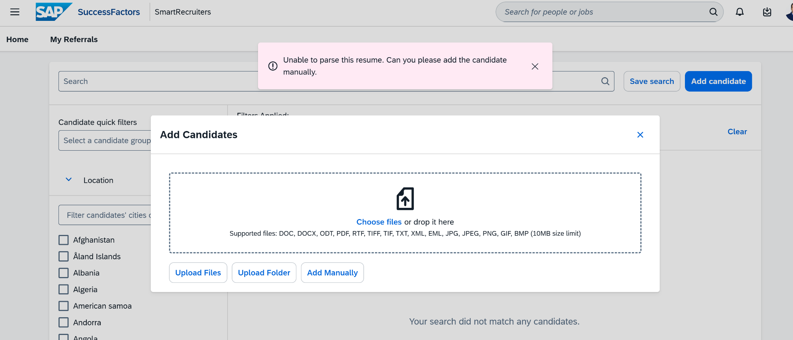

# HR02-INC-20261125-001 — Unable to parse CV
- **Incident ID:** HR02-INC-20261125-001
- **Reported:** 25 November 2026
- **Status:** Open — investigation pending
- **Product:** SmartRecruiters within SAP SuccessFactors (as shown in screenshot)
- **Area:** Add Candidates / CV upload
- **Impact:** The reported CV cannot be parsed to populate candidate details. Scope, frequency, severity and tenant are not yet confirmed.

## Observed error
> Unable to parse this resume. Can you please add the candidate manually.

The supplied screenshot shows the Add Candidates dialog and this error notification.

## Reproduction path to validate
1. Open SmartRecruiters and select **Add candidate**.
2. In **Add Candidates**, choose or upload a CV.
3. Observe the parsing error.
These steps are inferred from the screenshot; an independent reproduction has not been performed.

## Expected result
A valid supported CV is parsed and candidate information is populated for review.

## Actual result
A parsing error is displayed and the user is prompted to add the candidate manually.

## Available workaround
Use **Add Manually**, as offered by the interface. Successful manual creation has not been verified.

## Evidence

[Incident record](https://github.com/nbnayak88/learning-township/blob/main/01-HR-Human-Capital-Capability-Academy-Workforce-Monday/HR02-ATA2-Architecting-Autonomous-Talent-Acquisition/Incident/HR02-INC-20261125-001-unable-to-parse-cv.md)

## Investigation checklist
- [ ] Capture tenant/environment, user role, timestamp and timezone.
- [ ] Record failing CV extension, size and language; verify readability, text extraction and password protection.
- [ ] Compare with a known-good anonymized CV and another supported format.
- [ ] Confirm whether failure affects one CV, several files or all uploads.
- [ ] Capture sanitized network response/status, correlation ID and relevant console errors.
- [ ] Check tenant configuration, parser availability and access permissions.
- [ ] Escalate to the appropriate support team with sanitized evidence if reproducible.

The dialog advertises a 10 MB file limit and these formats: DOC, DOCX, ODT, PDF, RTF, TIFF, TIF, TXT, XML, EML, JPG, JPEG, PNG, GIF, BMP. The failing file's type and size are unknown. These displayed limits do not establish the cause.

## Closure criteria
- [ ] Root cause and corrective action documented.
- [ ] Original failing CV (or an anonymized equivalent) parses successfully.
- [ ] Candidate fields and manual creation fallback verified.
- [ ] Retest evidence recorded and incident closed.

**Root cause:** Not determined. No tenant or vendor defect has been confirmed.

## Tracking
[GitHub issue #5](https://github.com/nbnayak88/learning-township/issues/5)
