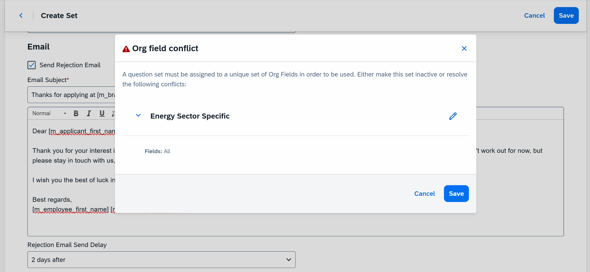

# SAP-specific skills question set — Org field conflict

- **Incident ID:** HR02-INC-20261126-ORG-CONFLICT-001
- **Reported:** 26 November 2026 (IST)
- **Product:** SAP SmartRecruiters
- **Area:** Question sets / Create Set / Org Field assignments
- **Status:** Open — assignment review and retest pending

## Summary
While creating a question set for SAP-specific skills, the reporter encountered an **Org field conflict** dialog. The dialog identifies an existing **Energy Sector Specific** set with **Fields: All**.

## Exact validation message
> A question set must be assigned to a unique set of Org Fields in order to be used. Either make this set inactive or resolve the following conflicts:

## Screenshot observations
- Page: Create Set.
- Dialog title: Org field conflict.
- Conflicting set: Energy Sector Specific.
- Assignment displayed beneath that set: Fields: All.
- Edit/pencil control, Cancel and Save are visible in the dialog.
- The underlying page shows Send Rejection Email selected and Rejection Email Send Delay of 2 days after. These are context only; no causal link is established.

## Actual result
Creation/configuration of the SAP-specific skills set is interrupted by the conflict validation. Successful save or activation has not been demonstrated.

## Expected result
The intended question set can be saved and used with a valid, unique Org Field assignment. If assignments conflict, the overlap can be identified and resolved without unintended changes to existing recruiting flows.

## Impact
The reporter cannot complete the intended usable SAP-skills question-set configuration until the assignment conflict is resolved. Affected jobs, users, tenant and production impact are not established.

## Reproduction path to validate
1. Open question-set configuration and select Create Set.
2. Configure questions for SAP-specific skills.
3. Assign the intended Org Fields and attempt to save/use the set.
4. Observe the Org field conflict dialog identifying Energy Sector Specific / Fields: All.
The exact new-set assignments and save sequence are not shown; these steps require tenant validation. No independent reproduction has been performed.

## Initial assessment
The dialog explicitly requires unique Org Field assignments. The existing set's All scope may overlap the proposed set; this is a diagnostic inference. The new set's assignments and the exact conflict matching rules remain unverified. This may be expected configuration validation rather than a product defect.

## Investigation and proposed resolution
- [ ] Record tenant, user role, new-set name and both sets' identifiers.
- [ ] Capture the full Org Field assignments and active/inactive state of both sets.
- [ ] Review Energy Sector Specific through its edit control and determine whether All is intentional.
- [ ] Define intended routing for energy-sector questions and SAP-skills questions, including jobs that require both.
- [ ] Confirm supported assignment matching rules and whether multiple sets can apply to one job.
- [ ] Have the configuration owner choose an appropriate supported design: distinct assignments, a combined set where needed, or an inactive draft.
- [ ] Narrow existing assignments only after reviewing affected jobs and intended coverage.
- [ ] If using the dialog's inactive-set option, verify which set is being made inactive and confirm the resulting state.
- [ ] Save and reload; test matching and nonmatching job scenarios.
- [ ] Verify correct questions and associated rejection-email behavior before closing.
- [ ] If fully distinct supported assignments still trigger a conflict, collect sanitized evidence and escalate.

No tenant settings have been changed. Do not deactivate the existing Energy Sector Specific set solely to dismiss this validation.

## Evidence

## Closure criteria
- [ ] Exact overlap or other cause documented.
- [ ] Intended assignment design agreed and configured.
- [ ] SAP-specific skills set saves with the intended active/inactive state.
- [ ] Job-level routing and existing question coverage verified.
- [ ] Retest evidence recorded and reporter informed.

**Resolution:** Not applied or verified.
