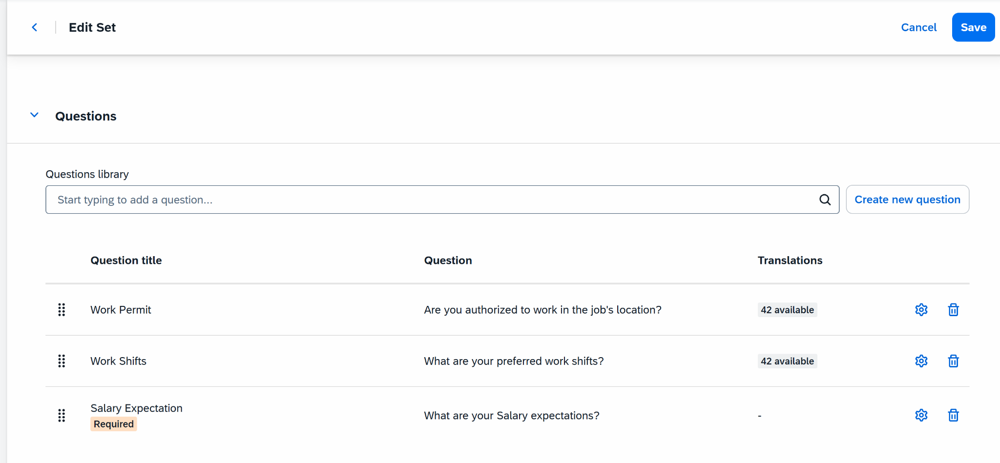

# Salary Expectation question — translations unavailable in Edit Set

- **Incident ID:** HR02-INC-20261126-TRANSLATIONS-001
- **Reported:** 26 November 2026 (IST)
- **Product:** SAP SmartRecruiters
- **Area:** Question set configuration / Edit Set / Questions / Translations
- **Status:** Open — investigation pending

## Summary
The reporter cannot find translations for the Salary Expectation question. In the same question set, Work Permit and Work Shifts each display **42 available**, while Salary Expectation displays **–** under Translations.

## Screenshot observations
| Question title | Question text | Translations | Required indicator |
|---|---|---|---|
| Work Permit | Are you authorized to work in the job's location? | 42 available | Not shown |
| Work Shifts | What are your preferred work shifts? | 42 available | Not shown |
| Salary Expectation | What are your Salary expectations? | – | Required |

All three rows display a settings gear and delete icon. The page includes Questions library, Create new question, Cancel and Save.

## Expected behavior / clarification requested
Clarify whether Salary Expectation supports the same 42-language coverage as the other questions, and provide the supported route to view or maintain its translations. If translations require separate maintenance or are unsupported for this question type, make that requirement clear.

## Actual behavior
The Salary Expectation row provides no translation count; the reporter cannot locate its translations. The screenshot alone does not show what opens through the settings gear or establish whether translated text exists elsewhere.

## Impact
The reporter cannot verify or configure multilingual wording for a required salary-expectation question. Candidate-facing language behavior and the number of affected jobs or users have not been tested. No production outage is established.

## Reproduction path to validate
1. Open the affected question set in Edit Set.
2. Expand Questions.
3. Compare the Translations column for Work Permit, Work Shifts and Salary Expectation.
4. Open Salary Expectation settings and check whether translation maintenance is available.
5. Compare candidate previews in relevant supported languages.
Steps beyond the visible list require tenant validation; no independent reproduction has been performed.

## Initial assessment
- Confirmed from screenshot: the first two questions show 42 available; Salary Expectation shows a dash.
- It is not established that every question automatically receives 42 translations.
- Whether Salary Expectation is a custom question or a standard library question is unknown.
- Possible explanations to investigate include question origin/type, missing translation maintenance, permissions, feature availability or a product defect. None is confirmed.
- The Required flag is visible but is not established as a cause.

## Investigation checklist
- [ ] Record tenant/environment, release/build, question-set name, question identifier/type and affected role.
- [ ] Determine whether each question is standard/library-provided or custom.
- [ ] Inspect Salary Expectation settings for supported translation controls and saved language entries.
- [ ] Confirm whether the 42-language statement applies to this question type and tenant.
- [ ] Compare with another authorized administrator and a comparable question.
- [ ] Obtain the exact supported translation-maintenance path from SAP/SmartRecruiters support.
- [ ] If manual translations are supported, maintain approved text and verify persistence after save/reload.
- [ ] Test candidate-facing wording and fallback behavior in selected languages.
- [ ] If expected translations remain unavailable, collect sanitized evidence and escalate as a defect; if unsupported, document the limitation and enhancement request.

## Vendor support request
Please explain why Work Permit and Work Shifts display 42 available translations while the required Salary Expectation question displays a dash. Confirm whether equivalent language coverage is supported, identify prerequisites, and provide the exact configuration steps or applicable limitation.

## Evidence

## Closure criteria
- [ ] Supported language coverage and question-type behavior confirmed.
- [ ] Cause and configuration procedure or product limitation documented.
- [ ] Applicable translations verified in configuration and candidate preview.
- [ ] Reporter receives the outcome and retest evidence.

**Resolution:** Not applied or verified.
