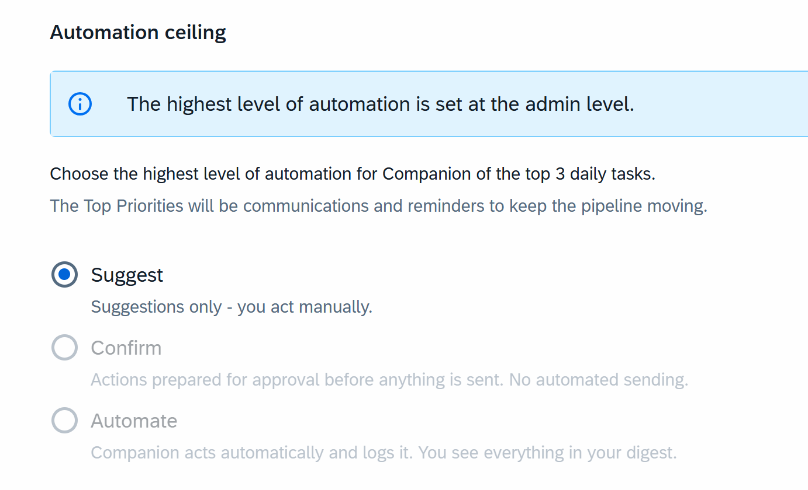

# Winston configuration — unable to switch automation options

- **Incident ID:** HR02-INC-20261126-WINSTON-001
- **Reported:** 26 November 2026 (IST)
- **Product / area:** SmartRecruiters Winston Companion — Automation ceiling
- **Status:** Open — investigation pending

## Reported behavior
The user cannot switch between all three automation options: Suggest, Confirm and Automate.

## Screenshot observations
| Option | Description shown | Visible state |
|---|---|---|
| Suggest | Suggestions only - you act manually. | Selected |
| Confirm | Actions prepared for approval before anything is sent. No automated sending. | Greyed out; appears disabled |
| Automate | Companion acts automatically and logs it. You see everything in your digest. | Greyed out; appears disabled |

The page displays: **“The highest level of automation is set at the admin level.”**
The setting concerns Companion's top 3 daily tasks, with communications and reminders to keep the pipeline moving.

## Expected behavior
An authorized user can select any automation level permitted by the administrator's configured ceiling. If a level is restricted, the applicable policy should be clear.

## Impact
Configuration of approval-based or automatic Companion actions is blocked for the reporting user. Tenant scope, other affected users and production impact are not established.

## Reproduction path to validate
1. Open Winston Companion configuration.
2. Locate **Automation ceiling**.
3. Attempt to select **Confirm**, then **Automate**.
4. Check whether selection changes and can be saved.
These steps are based on the report and supplied screenshot; independent tenant reproduction has not been performed.

## Initial assessment
The admin-level ceiling message suggests a policy restriction may explain the disabled options. The actual administrator setting, user permissions, feature entitlement and root cause have not been verified. A product defect is not confirmed.

## Investigation and proposed next actions
- [ ] Record tenant/environment, affected role, browser and reproduction time.
- [ ] Ask an authorized administrator to inspect the tenant's Winston/Companion automation ceiling.
- [ ] Compare permitted levels with the affected user's configuration; confirm required permissions and feature availability.
- [ ] If broader automation is intended and approved by the organization, have the administrator adjust the ceiling.
- [ ] Refresh the session and retest Suggest, Confirm and Automate as permitted by policy.
- [ ] If options remain disabled despite verified configuration and access, collect sanitized network/console evidence and raise a vendor support case.

## Interim workaround
Continue with **Suggest** and perform actions manually while the administrator reviews the restriction. No configuration change has been applied.

## Evidence

## Closure criteria
- [ ] Cause documented: policy restriction, access/entitlement issue or confirmed defect.
- [ ] Intended automation ceiling confirmed by the administrator.
- [ ] Permitted options can be selected and saved, with retest evidence recorded.
- [ ] If restriction is intentional, document it and obtain reporter confirmation before closure.
