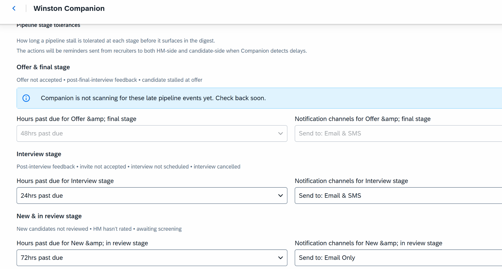

# Winston Companion — pipeline tolerance hours limited; offer stage disabled

- **Incident ID:** HR02-INC-20261126-WINSTON-002
- **Reported:** 26 November 2026 (IST)
- **Status:** Open — configuration clarification and investigation pending
- **Area:** SAP SmartRecruiters / Winston Companion / Pipeline stage tolerances

## User report
Early and mid-stage tolerance dropdowns allow only 24, 48 and 72 hours. The user cannot enter a custom number of hours. The Offer & final stage hours field is frozen and cannot be edited.

## Screenshot evidence
| Stage | Hours displayed | Channel displayed | Observed / reported behavior |
|---|---|---|---|
| New & in review | 72 hours past due | Email Only | Dropdown appears enabled; user reports only 24/48/72 choices |
| Interview | 24 hours past due | Email & SMS | Dropdown appears enabled; user reports only 24/48/72 choices |
| Offer & final | 48 hours past due | Email & SMS | Hours and channel controls appear greyed out |

The screenshot does not show expanded dropdown choices; the available 24/48/72 values are user-reported.
The offer section explicitly states: **“Companion is not scanning for these late pipeline events yet. Check back soon.”**
Several labels also display the literal HTML entity `&amp;`; this is a secondary display observation.

## Meaning of this setting
The screen describes the tolerance as how long a pipeline stall is tolerated before it surfaces in the digest. This is not evidence of a recurring reminder interval. The screen describes reminders to hiring-manager and candidate sides when Companion detects delays.

## Expected / requested behavior
Clarify whether arbitrary hour thresholds are supported for each stage, or whether this version intentionally permits only preset values. Permit configuration for stages that are supported and enabled; clearly explain restrictions for unavailable stages.

## Impact
The user cannot align pipeline stall thresholds with business-specific timing outside the reported presets. Offer-stage monitoring and threshold configuration cannot be validated from this screen. No production outage or wider user impact is established.

## Reproduction path to validate
1. Open Winston Companion settings and locate Pipeline stage tolerances.
2. Expand the New & in review and Interview stage hours dropdowns.
3. Check available choices and whether a custom number can be entered.
4. Attempt to change the Offer & final stage hours.
5. Record the unavailable-scanning banner and disabled controls.
Independent tenant reproduction has not been performed.

## Assessment
- The offer-stage banner is direct evidence that late-pipeline scanning is unavailable in the displayed environment. It plausibly explains the disabled field; this is an inference, not a verified root cause.
- The preset-only controls may be an intentional product limitation. An alternate supported admin setting/API for custom hours has not been established.
- Do not assume the automation ceiling from related incident #10 controls these tolerance fields.
- No product defect is confirmed.

## Investigation / vendor questions
- [ ] Capture tenant, release/build, user role and expanded dropdown evidence.
- [ ] Confirm whether 24/48/72 hours are the supported fixed choices for this release.
- [ ] If custom values are supported, provide the exact documented admin path, permission, validation limits and scope.
- [ ] Confirm whether thresholds use elapsed/calendar hours or business hours and what event starts/resets the clock.
- [ ] Confirm stage grouping and whether thresholds can differ by job, hiring process or individual stage.
- [ ] Confirm offer/final scanning availability and any tenant entitlement or rollout prerequisite.
- [ ] Determine whether disabled offer controls are expected; log a defect only if they contradict supported behavior.
- [ ] If custom values are unsupported, route that requirement as an enhancement.
- [ ] Retest permitted settings and persistence after save/reload.

## Interim guidance
Use the available presets for supported stages while awaiting clarification. Continue manual offer-stage follow-up; the displayed 48-hour value does not establish that monitoring is active.

## Evidence

## Reference checked
[SmartRecruiters October 2026 product release](https://www.smartrecruiters.com/recruiting-software/whats-new/october-2026-product-release/) describes Top Priorities and follow-up suggestions but does not establish support for arbitrary hour values or offer-stage enablement. Exact configuration remains unverified.

## Related incident
#10 — Automation ceiling options unavailable. Tracked separately.

## Closure criteria
- [ ] Supported threshold options and stage availability confirmed.
- [ ] Configuration limitation, prerequisite or defect documented with evidence.
- [ ] Supported thresholds persist after save/reload.
- [ ] Reporter receives the supported configuration route, or a documented limitation and enhancement route.
