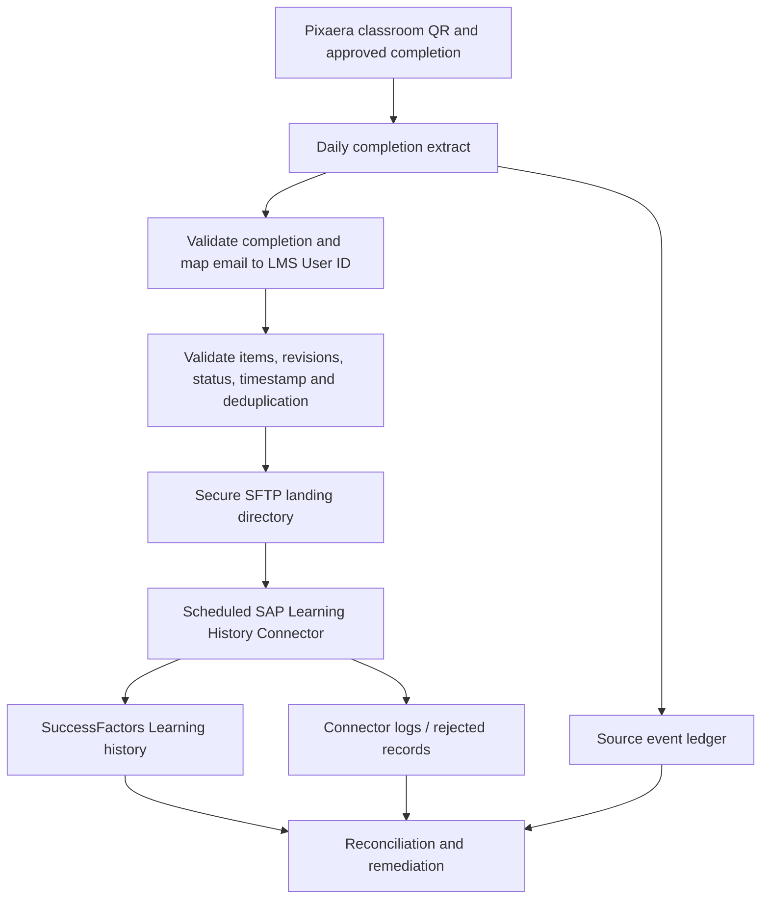

> **Sector edition:** GICS Industrials; Pixaera public case-study references: PCL Construction. These references do not establish that the companies use the specific SAP integration described here.
>
> **Sector learning overlay:** Construction-site induction, working at heights, lifting operations, subcontractor safety, site-specific compliance and project workforce mobility.

# Pixaera → SAP SuccessFactors Learning — Solution Architect Configuration Runbook

**SuccessLabs Academy · HR06 / ALM6 · Industrials Sector · Essentials Workshop**  
**Version:** 1.0 (2026-11-20) · **Lifecycle:** design → SIT → UAT/CAB → production

## 1. Goal and boundaries
Pixaera captures approved classroom completions and sends a scheduled file to SuccessFactors Learning for learner-history credit. This is **inbound learning-history integration**, not a two-way course launch or content synchronization interface. Do not assume the document proves the endpoint is provisioned or any connector configured.

## 2. Target logical architecture


## 3. Eleven ordered implementation work packages

| WP | Work package | Detailed configuration and validation | Evidence / exit criteria |
|---|---|---|---|
| 01 | Scope and prerequisites | Confirm test and production tenants, LMS release, admin access, system of record for users, completion definition, existing connector schedules and required reporting. | Approved interface scope and inventory |
| 02 | Identity | In Learning Administration > People > Users inspect user ID, email, status and identifiers for representative employees/contractors. Confirm if email equals exact LMS User ID; otherwise build authorized email-to-user-ID lookup with unmatched/ambiguous exception handling. | Redacted identity mapping and sign-off |
| 03 | SFTP | With SAP administration confirm tenant-specific managed SFTP account, host key, auth, folder, filename and permissions. Use non-production credentials and never store secrets in GitHub. Verify connectivity, upload and file visibility. | Secure transport test |
| 04 | Status | Inspect Learning Administration > References > Learning > Completion Statuses. Reuse a suitable credit-bearing status or create PIX-COMPLETE with correct item-type applicability. | Approved status ID and credit behavior |
| 05 | Item master | In Learning Administration > Learning Activities > Items (menu varies), decide on existing/PIXAERA item type. Create stable mapped item IDs, description, owners, revision and configured credit hours; determine catalog visibility and any assignment impact. | Item mapping register |
| 06 | File mapping | Build `STUD_ID`, `CPNT_TYP_ID`, `CPNT_ID`, `REV_DTE`, `CMPL_STAT_ID`, `COMPL_DTE`; ensure canonical IDs, correct date formats/time zone, approved source events, valid statuses and references. | Mapping specification and validated sample |
| 07 | Connector configuration | Review System Administration > Configuration > System Configuration > CONNECTORS. Confirm whether history connector enabled, CSV parsing, delimiter, suffix, header handling, directory and error notification; preserve configuration baseline. | Validated connector properties |
| 08 | Schedule | In automatic processes, find Learning History Connector and schedule after vendor file arrival and after dependent master data loads; protect against overlapping jobs and define retry policy. | Recorded schedule / completed test run |
| 09 | SIT | Upload controlled test file and inspect connector logs, rejected rows, learner history, timestamp and hours. Test invalid user/item/status/date, duplicate source event, replay and mixed batches. | SIT test log and reconciliation |
| 10 | UAT / CAB | Obtain business evidence for accepted completions, hours and compliance/reporting effects; agree operational ownership and change backout procedures; secure CAB approval. | UAT and CAB sign-offs |
| 11 | Production | Repeat approved configuration for production with separate SFTP credentials; smoke test, enable scheduled delivery, daily monitoring, reconciliation and hypercare. | Production release record |

**Menu locations are representative and vary by SAP Learning tenant/release and admin roles.**

## 4. File layout and identity rules

| Field | Meaning | Example | Validation |
|---|---|---|---|
| `STUD_ID` | Existing canonical LMS User ID | `ENG004567` | Not an email lookup. Email-formatted only when identical to LMS User ID |
| `CPNT_TYP_ID` | Learning item type | `PIXAERA` | Must exist |
| `CPNT_ID` | Learning item identifier | `PIX-WAH-01` | Must exist in type |
| `REV_DTE` | Revision date | `JAN-01-2026 00:00:00` | Match configured item revision, otherwise document omission behavior |
| `CMPL_STAT_ID` | Completion status | `PIX-COMPLETE` | Must be valid and credit-bearing if credit required |
| `COMPL_DTE` | Completion timestamp | `NOV-20-2026 14:30:00` | **Not `CMPL_DTE`**; confirm format/time-zone convention |

Illustrative CSV with a header **only if the tenant's configuration accepts a header**:

```csv
STUD_ID,CPNT_TYP_ID,CPNT_ID,REV_DTE,CMPL_STAT_ID,COMPL_DTE
ENG004567,PIXAERA,PIX-WAH-01,JAN-01-2026 00:00:00,PIX-COMPLETE,NOV-20-2026 14:30:00
```

The standard SAP Learning History Connector file name follows the `learninghistory_data_<tenant-suffix>.txt` convention in documented configurations. Verify specific tenant suffix, format and extension before deploying. Never assume `.txt` means tab-delimited or `.csv` means CSV mode is active.

## 5. Connector properties to inspect, not blindly override

- `learninghistory.connector.input.file.format.csv.enable`: confirm CSV support/setting and applicable release.
- `connector.input.file.columnDelimiter`: confirm impact on this and any other connectors.
- `connector.input.file.name.tenant.suffix.override`: inspect naming rule, if applicable.
- Confirm all other connector-specific schedule, header, file path and notification settings in the actual tenant and SAP documentation.
- Do not put secrets, actual employee exports or production host details in this public repository.

## 6. Business and architectural choices

| Decision | Option A | Option B | Phase-1 position |
|---|---|---|---|
| Learning history | Item-based placeholder | Scheduled-offering/class-based | Item-based unless session-level LMS governance required |
| User ID | Email equals existing User ID | Transform email to canonical User ID | Validate first; never assume |
| Credit hours | Configure standard hours on item | File-specific actual hours | Item defaults if business policy is uniform |
| Integration transformation | Pixaera export rules | SAP Cloud Integration or equivalent | Use deterministic minimum-complexity mapping |
| Processing | Daily native connector batch | Near real-time API/event solution | Daily batch if SLA permits |

## 7. SIT/UAT test matrix

| ID | Test | Expected |
|---|---|---|
| 01 | Existing LMS ID and valid item | Correct history entry |
| 02 | Email identical to LMS user ID | Accepted after field validation |
| 03 | Email differs from user ID | Resolve upstream; reject raw unmatched email |
| 04 | Unknown user | Error isolated |
| 05 | Unknown item/type | Error isolated |
| 06 | Invalid status | Error isolated |
| 07 | Wrong revision | Correct validation/rejection |
| 08 | Bad/future timestamp | Defined validation, no accidental credit |
| 09 | File header/delimiter mismatch | Parsing error detected |
| 10 | Repeated event/file | No unintended duplicate history |
| 11 | Legitimate repeat training | Retake posted according to business rule |
| 12 | Different learners, same item | Correct separate entries |
| 13 | Credit hours | Matches approved policy |
| 14 | Time-zone boundary | Correct effective date/time |
| 15 | Mixed valid/rejected rows | Reconciled by event |
| 16 | SFTP auth outage | Alert and controlled recovery |
| 17 | Late item/user master data | Safe hold and replay |
| 18 | Production smoke | Signed-off visible history |

A test outcome is **not** marked passed until actual logs and screenshots prove it.

## 8. Operational controls and handover

- Source ledger: event ID, source learner reference, module ID, timestamp, source approval, export batch.
- Mapping ledger: canonical LMS User ID, item type/ID/revision, completion status.
- Import ledger: file ID, connector run ID, posted/rejected/pending counts, remediation owner.
- Reconciliation invariant: source-approved events = posted + rejected + pending (adjust for intentional exclusions and retries; never double-count a retried event).
- Access: least privilege, SFTP SSH validation, managed credentials, retention and privacy controls.
- Incident response: assign business impact, retry policy, replay guard and ownership of corrections.
- CAB artifacts: architecture diagram, data contract, SIT/UAT results, runbook, security validation and rollback plan.

## 9. Workshop activities (2–3 hours)

1. **20 min** — context, business capability and choice of item versus scheduled offering.
2. **30 min** — identity check: email versus STUD_ID, source-to-target mapping and data contract.
3. **25 min** — role-play SFTP security, connector configuration and schedule dependencies.
4. **30 min** — run SIT cases and inspect mock rejected rows; document deterministic remediation.
5. **30 min** — architecture review across 12 streams; record decision/risk/evidence per stream.
6. **15 min** — present CAB-ready architecture decision summary and next actions.

**Student outputs:** annotated architecture diagram, field mapping, identity ADR, SIT cases and reconciliation design.

## 10. Go/no-go gates

- **Gate A: Identity:** LMS User ID mapping verified against redacted tenant examples.
- **Gate B: Data contract:** approved headers, file format, date/time rules, IDs and status.
- **Gate C: Security:** approved SFTP endpoint, access and secret handling.
- **Gate D: Functional:** histories and credit hours validated without unintended duplicates.
- **Gate E: Operability:** alerts, replay, reconciliation and assigned owners.
- **Gate F: Release:** UAT and CAB approval before switching production delivery.

## 11. Primary source and caveat
SAP Help: [Learning History Connector](https://help.sap.com/doc/f04490ba96cc4de3a59cf34f3a9d0c46/2405/en-US/SF_LRN_Learning_History_Connector.pdf). Cross-check the applicable tenant release. Pixaera's two-page Engro November 2026 proposal is the business input and includes assumptions requiring validation. No EngroT system configuration, SIT or production validation has been performed by this document.
