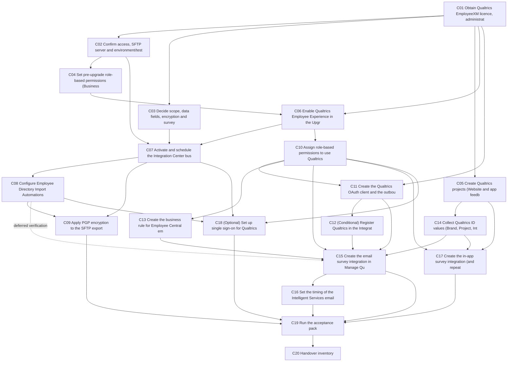

# SAP SuccessFactors x Qualtrics - Configuration Sequence Journal (General Template)

**Version:** v0.2 (aligned to SAP guide edition 2605; draft for project customisation)  
**Date:** 2026-11-04  
**Result label:** Design simulation only (all cards 'Designed - not executed')

## 1. Promise and boundary

A dependency-ordered, auditable build sequence for integrating SAP SuccessFactors with Qualtrics (EmployeeXM), written as a general template you can customise per project. It does not claim any tenant result. Each card is `Designed - not executed` until you add observed evidence. Production deployment belongs to your project's Deploy process; card C17 only prepares the handover inventory.

**Labels used:** *Policy* = approved assumption you decide; *SAP-documented* = from SAP Help or a KBA; *Community* = SAP Community blog, to be validated; *Tenant-verified* = observed in your system (none yet).

## 2. Scope and out of scope

**In scope:** enablement in SuccessFactors, permissions, employee directory feed to Qualtrics, Qualtrics licence and projects, Upgrade Center enablement, Integration Center employee export, Qualtrics directory import automation, PGP encryption, role-based permissions, OAuth, business rule, email survey integrations and timing, in-app survey integrations, optional SSO, acceptance pack, registers, handover inventory.

**Out of scope:** survey content design, Qualtrics dashboards and analytics, Qualtrics-side licensing negotiation, production cutover execution, any module not named above (for example Learning-specific feedback flows, 360 report design) until your project adds them.

## 3. Entry gate

| Gate | Needed before C04 |
|---|---|
| Release | SuccessFactors tenant and release known; guide edition matched to it |
| Access | SuccessFactors admin; Qualtrics brand administrator |
| Licence | Qualtrics EmployeeXM (Employee Experience) licence |
| Data | Population filter and field list agreed (C03) |
| Integration | SFTP details, Qualtrics tenant URL, OAuth ownership agreed |

## 4. Policy oracle (synthetic, training assumptions)

| ID | Persona | Event | Expected result |
|---|---|---|---|
| P1 | Synthetic new hire | Hire effective on a fixed test date | Appears in the SFTP export, in the Qualtrics directory by user ID, and receives the configured survey at the configured timing |
| P2 | Synthetic employee in matching business unit | Department change on a fixed date | Rule matches; survey sent if the department-change integration is in scope |
| P3 | Synthetic employee outside the rule | Same event | No survey |
| P4 | Synthetic administrator | Edit on QualtricsEmailSurveyData | Sees the Email Surveys tab |
| P5 | Synthetic user without Qualtrics permissions | None | Cannot open Manage Qualtrics Integrations and sees no in-app surveys |
| P6 | Synthetic test user with 'test' prefix | Exists only in a non-production tenant | Must never appear in the production Qualtrics directory |

## 5. Dependency map

Build order differs from runtime order: the email survey integration (C15) is **built** after OAuth (C11), the rule (C13) and the IDs (C14), but it **fires** only when the Intelligent Services event publishes, and the timing (C16) is set after the integration exists. C15 is fully proven only once the employee directory import (C08) has loaded contacts, so that edge is deferred-verification. The guide also places role-based permissions (C10) after the export and directory steps (C07 to C09), even though the permissions chapter is numbered earlier.

## 6. Configuration cards

### Phase A - Prepare / Explore - licence, access, decisions

#### C01 - Obtain Qualtrics EmployeeXM licence, administrator account and tenant URL

| Field | Content |
|---|---|
| Depends on | None (entry card) |
| Surface | Qualtrics account team (G-4) |
| Policy input | Use cases in scope (from the guide's product-area list, G-2). Policy assumption: recruiting-heavy campaigns may need Qualtrics' separately licensed Candidate Experience programme (SAP-documented note). |
| Actions | 1. Obtain the Qualtrics Employee Experience (EmployeeXM) licence and tell the Qualtrics representative you are an SAP SuccessFactors customer. 2. Obtain the Qualtrics administrator account tied to the licence. 3. Obtain the account-specific tenant URL (format https://<tenant_URL>.qualtrics.com). |
| Expected result | Licence, administrator login and tenant URL held by the project. |
| Verify | Positive: administrator can log in to Qualtrics. Negative: a user without the admin account cannot create projects. |
| Evidence | Licence confirmation reference, admin login test (no credentials recorded). |
| Failure diagnosis | Missing URL blocks the Upgrade Center step (C06). |
| Recovery | Documentation only. |
| Owner / State / Minutes | To complete / Designed - not executed / To complete |
| Sources | G-4 |

#### C02 - Confirm access, SFTP server and environment/test-data strategy

| Field | Content |
|---|---|
| Depends on | C01 |
| Surface | Project governance; SAP implementation partner; Qualtrics |
| Policy input | Who holds RBP Admin, who can reach Provisioning, which SFTP server is used, and how non-production testing avoids polluting the single Qualtrics tenant. |
| Actions | 1. Confirm an RBP Admin and that Upgrade Center is enabled in the instance (G-6, G-7). 2. Confirm an SFTP server with host, port 22, user and password for the employee export (G-12). 3. Confirm who can use Provisioning, which customers do not have; the guide says contact the implementation partner or account executive (G-17). 4. Decide the test approach: a standard licence gives a single Qualtrics tenant, so options are a paid Qualtrics sandbox tenant, test projects only, syncing a reduced population, or a 'test' prefix or suffix on test user IDs (G-24). |
| Expected result | Access map and environment strategy approved. |
| Verify | Positive: each named role can open its tool. Negative: a customer-side user without Provisioning access is not assumed to have it. |
| Evidence | Access checklist (tool names only), environment decision record. |
| Failure diagnosis | Test users pushed to the single Qualtrics tenant create duplicate or junk directory data that is hard to clean. |
| Recovery | Documentation only. |
| Owner / State / Minutes | To complete / Designed - not executed / To complete |
| Sources | G-6, G-7, G-12, G-17, G-24 |

#### C03 - Decide scope, data fields, encryption and survey patterns

| Field | Content |
|---|---|
| Depends on | C01 |
| Surface | Design decision record |
| Policy input | Product areas and survey types (email via Intelligent Services events; in-app via intercepts); fields sent to Qualtrics; PGP encryption (SAP recommends it); SSO yes/no and IdP. |
| Actions | 1. Pick the product areas and survey types from G-2. 2. Decide which optional CSV fields (department, division, location, role and so on) to keep or remove, because any data in those fields is stored in Qualtrics (G-12). 3. Decide PGP encryption (recommended, G-15). 4. Decide whether SSO is in scope; Identity Authentication service is the recommended IdP (G-17). 5. Confirm no sensitive data goes in the export: read audit logging for OData reads is off by default, so raise a support ticket to enable tenant-level logging if sensitive data must be sent (G-12, G-14). |
| Expected result | One pattern per use case; field list and encryption decision recorded. |
| Verify | Every in-scope use case has a pattern, owner and survey; out-of-scope items are listed. |
| Evidence | Decision record ID. |
| Failure diagnosis | Unclear scope causes rework in C07 and C15. |
| Recovery | Documentation only. |
| Owner / State / Minutes | To complete / Designed - not executed / To complete |
| Sources | G-2, G-12, G-14, G-15, G-17 |

### Phase B - Realize - Permissions and enablement in SuccessFactors

#### C04 - Set pre-upgrade role-based permissions (Business Scenarios and Integration Center)

| Field | Content |
|---|---|
| Depends on | C02 |
| Surface | Admin Center > Manage Permission Roles (as RBP Admin) |
| Policy input | Which administrator role runs the upgrade and the integration scenario. |
| Actions | 1. Log in as RBP Admin. 2. Under Administration, Manage Integration Tools, grant the permission that lets the administrator access the Qualtrics integration business scenario, and the permission Access to Business Scenarios. 3. Grant Access to Integration Center. (Exact labels as in G-6; validate in your release.) |
| Expected result | The administrator can reach Business Scenarios and the Integration Center before running the upgrade. |
| Verify | Positive: admin sees Business Scenarios. Negative: a user without these permissions does not. |
| Evidence | Role name, permission list, test user result. |
| Failure diagnosis | If the Qualtrics upgrade or scenario is not visible later, check these permissions first (the guide says so in G-7 and G-12). |
| Recovery | Remove permissions from the role; nothing else changes yet. |
| Owner / State / Minutes | To complete / Designed - not executed / To complete |
| Sources | G-6 |

#### C05 - Create Qualtrics projects (Website and app feedback for in-app, Lifecycle for email)

| Field | Content |
|---|---|
| Depends on | C01 (independent of SuccessFactors cards) |
| Surface | Qualtrics projects under EmployeeXM |
| Policy input | Survey content, distribution, participants, dashboards and prompting approved by HR. |
| Actions | 1. Log in to Qualtrics with the admin account. 2. Set up the feedback survey. 3. Decide distribution and participants. 4. Configure dashboards. 5. Decide how visitors are prompted. 6. Configure and deploy the project. You may do this before the SuccessFactors integration is complete. |
| Expected result | Tested Qualtrics projects ready for later integration. |
| Verify | Positive: survey link works standalone. Negative: unpublished project is not used in production integrations. |
| Evidence | Project names (IDs masked), standalone test response. |
| Failure diagnosis | Wrong project type for the use case (in-app needs Website/app feedback; email needs Lifecycle). |
| Recovery | Deactivate the project in Qualtrics; history stays. |
| Owner / State / Minutes | To complete / Designed - not executed / To complete |
| Sources | G-5 |

#### C06 - Enable Qualtrics Employee Experience in the Upgrade Center

| Field | Content |
|---|---|
| Depends on | C01, C04 (hard) |
| Surface | Admin Center > Upgrade Center > Optional Upgrades > Qualtrics Employee Experience > Learn More & Upgrade Now |
| Policy input | Tenant URL from C01 approved for this SuccessFactors tenant. SAP text: the upgrade can be undone within 30 days. |
| Actions | 1. Open the Qualtrics Employee Experience upgrade and select Upgrade Now. 2. Enter the Qualtrics URL in the Enter Qualtrics Server URL dialog and select Validate until you see 'The URL is valid'. 3. Select Submit, then Yes to confirm. 4. Note the confirmation text: activate the business scenario, set up the directory import in Qualtrics, then finish role-based permissions. |
| Expected result | Feature Enabled status in Upgrade Center; Qualtrics business scenario appears in Business Scenarios. |
| Verify | Positive: status shows enabled and the scenario is listed. Negative: invalid URL cannot be submitted (buttons stay disabled). |
| Evidence | Upgrade Center status screenshot reference, URL (tenant name masked in shared copies). |
| Failure diagnosis | Option missing: check C04 permissions and that Upgrade Center is enabled. Scenario missing after upgrade: check permissions, then contact Technical Support. |
| Recovery | Undo within 30 days via Upgrade Center (Actions > Undo, then run again with the right URL). After 30 days undo is blocked; use Admin Center > Platform Feature Settings > Enable Qualtrics Feature to run it again (G-8). Survey integrations depend on this URL. |
| Owner / State / Minutes | To complete / Designed - not executed / To complete |
| Sources | G-7, G-8, G-9 |

### Phase C - Realize - Employee data feed, Qualtrics directory and permissions

#### C07 - Activate and schedule the Integration Center business scenario: Qualtrics Integration Definition - EC (or Basic) User Export to SFTP

| Field | Content |
|---|---|
| Depends on | C06, C02 (SFTP details), C03 (field decision) |
| Surface | Admin Center > Integration Center > Business Scenarios |
| Policy input | SFTP destination, schedule (SAP recommends a regular schedule, optimally daily) and which optional CSV fields stay. |
| Actions | 1. Open Business Scenarios and find 'Qualtrics Integration Definition - EC User Export to SFTP' (Employee Central customers) or 'Basic User Export to SFTP'. A legacy 'User Export to SFTP' scenario is deleted and replaced, not upgraded (G-13). 2. Move Active to On and confirm. 3. Review, but do not modify, the prepopulated integration details (CSV, simple header, no footer, read access logging on). 4. On Configure Fields, remove optional fields you do not want stored in Qualtrics. 5. Leave Filter and Sort. 6. Destination Settings: SFTP host, port 22, user name, password; file name prefix EMPLOYEE_EXPORT stays; file goes to the SFTP root unless a folder is set. 7. Scheduling: choose Once or a recurring schedule. 8. Review and Run: save, then Run Now. |
| Expected result | CSV file with user ID, first name, last name, email (and any kept optional fields) lands on the SFTP server on the chosen schedule. |
| Verify | Positive: file exists with expected columns and row count. Negative: removed optional fields are absent. Duplicate: no duplicate records (if present see KBA 2776691). Boundary: new hire and terminated user on the run date. |
| Evidence | Integration run ID, file name, column list, row count. |
| Failure diagnosis | Scenario not listed: C06 and C04. No file: SFTP credentials and host, then scheduler. Duplicate rows: KBA 2776691. |
| Recovery | Deactivate the scenario. Files already on SFTP remain, and Qualtrics may already have imported them (check C08). SFTP files follow the SAP purge policy (KBA 2620488). |
| Owner / State / Minutes | To complete / Designed - not executed / To complete |
| Sources | G-12, G-13, G-18; K2, K4 |

#### C08 - Configure Employee Directory Import Automations in Qualtrics (choose encryption, download public key)

| Field | Content |
|---|---|
| Depends on | C07 (hard: first part of the integration must be run) |
| Surface | Qualtrics administrator account > Directory > Automations > Employee Directory Import Automations |
| Policy input | Unique identifier is the user ID, never the email address (SAP caution). Encryption: Yes (from C03). |
| Actions | 1. Log in to Qualtrics as administrator. 2. In the Automations tab start Employee Directory Import Automations. 3. In Select Import File answer Yes to 'Do you plan to encrypt the files before upload?'. 4. Select Continue and Download our Public Key (pgppublickey.asc). 5. Complete the remaining automation settings, including the SFTP server and a regular schedule (per Qualtrics documentation). |
| Expected result | Directory import automation configured; Qualtrics public PGP key downloaded. |
| Verify | Positive: a test employee appears in the Qualtrics directory with mapped fields. Negative: email is not the identifier. Duplicate: second import does not duplicate contacts. |
| Evidence | Qualtrics automation name and last run result, directory contact count. |
| Failure diagnosis | Import errors: check file name and location on SFTP, then encryption setting (C09), then mapping. |
| Recovery | Disable the automation and remove imported test contacts using Qualtrics procedures; confirm no survey targets them. |
| Owner / State / Minutes | To complete / Designed - not executed / To complete |
| Sources | G-14 |

#### C09 - Apply PGP encryption to the SFTP export

| Field | Content |
|---|---|
| Depends on | C08 (key), C07 (hard) |
| Surface | Admin Center > PGP Key Management; Integration Center > Business Scenarios > Destination Settings > Advanced Settings |
| Policy input | Encryption decision from C03 (recommended by SAP; optional). |
| Actions | 1. Confirm you have role-based permission to import a key in PGP Key Management. 2. Import the Qualtrics public key (pgppublickey.asc) and name it Qualtrics_PGP. 3. Edit the business scenario, go to Destination Settings, Advanced Settings, and set File Encryption to Qualtrics_PGP. 4. Skip Scheduling and Run Now on Review and Run. |
| Expected result | Exported file is encrypted and decrypted successfully by the Qualtrics automation. |
| Verify | Positive: Qualtrics imports the encrypted file. Negative: an unencrypted file is rejected when encryption is on. |
| Evidence | Key name, run ID, Qualtrics import log. |
| Failure diagnosis | Decryption errors: check the key imported is the Qualtrics public key and was selected in the scenario. |
| Recovery | Remove the File Encryption selection and turn encryption off in the Qualtrics automation together. |
| Owner / State / Minutes | To complete / Designed - not executed / To complete |
| Sources | G-15 |

#### C10 - Assign role-based permissions to use Qualtrics

| Field | Content |
|---|---|
| Depends on | C06 (hard); sequence in guide: after C07/C08 |
| Surface | Admin Center > Manage Permission Roles |
| Policy input | Role design: who administers integrations and who only sees surveys. |
| Actions | 1. As RBP Admin grant Administration > Admin Center Permissions: the permission for administrators to open Manage Qualtrics Integrations, and Access Qualtrics Integration (admins and users). 2. Optionally grant Show Qualtrics in Main Navigation Menu. 3. Under Miscellaneous Permissions grant QualtricsProjectAndSiteData (Edit for admins to see the In-App Survey tab; View for users to see in-app surveys) and QualtricsEmailSurveyData (Edit for admins to see the Email Survey tab; View for users to receive survey emails). 4. Grant Metadata Framework > Configure Business Rules. 5. Grant Intelligent Services > Event Center to the user who enables Intelligent Services. 6. Grant Access to OAuth Configurations (View) for C11. Exact labels per G-16 and G-27; validate in your release. |
| Expected result | Admins see Manage Qualtrics Integrations with the correct tabs; end users see only what they should. |
| Verify | Positive: admin opens both tabs. Negative: admin without Edit on a data permission does not see that tab; user without View does not see surveys. Role separation checked. |
| Evidence | Role names, permission list, test user results. |
| Failure diagnosis | Tab missing: check the matching Edit permission first. |
| Recovery | Remove permissions from the role; existing integrations remain until deleted. |
| Owner / State / Minutes | To complete / Designed - not executed / To complete |
| Sources | G-16, G-27 |

### Phase D - Realize - Survey integrations (email and in-app)

#### C11 - Create the Qualtrics OAuth client and the outbound OAuth configuration in SuccessFactors

| Field | Content |
|---|---|
| Depends on | C01, C10 (Access to OAuth Configurations) |
| Surface | Qualtrics OAuth Client Manager; Admin Center > Security Center > Manage Security Center > Outbound OAuth Configurations |
| Policy input | Credential ownership, secret storage and rotation. One configuration can serve all email survey integrations. |
| Actions | 1. In Qualtrics create an OAuth client in the OAuth Client Manager and keep client ID, secret and scope details secure. 2. In SuccessFactors add an outbound OAuth configuration: unique Configuration Name, OAuth 2.0, Grant Type Client_Credentials, Client ID, Client Secret, Token URL https://<datacenter>.qualtrics.com/oauth2/token (add scopes as a query string if used), Token Method POST. 3. Save. |
| Expected result | OAuth configuration is selectable in the email survey integration. |
| Verify | Positive: configuration appears in the OAuth Configuration field of C15. Negative: wrong secret fails with an authentication error. Boundary: SAP cautions that a single scope given as scope=<scope> generates an error, and with multiple scopes the order matters (all first, then activity_logs). |
| Evidence | Configuration name and creation date; no secrets. |
| Failure diagnosis | Blank OAuth field in C15 means no configuration exists. Token errors: check URL, scope string and order. |
| Recovery | Delete the configuration in SuccessFactors and the client in Qualtrics; integrations using it stop working. |
| Owner / State / Minutes | To complete / Designed - not executed / To complete |
| Sources | G-27 |

#### C12 - (Conditional) Register Qualtrics in the Integration Service Registration Center

| Field | Content |
|---|---|
| Depends on | C11 (hard) |
| Surface | Admin Center > Integration Service Registration Center > Integration Service = Qualtrics |
| Policy input | Needed only for the integrations the guide names: Learning (assignment completion), Employee Central change in department, Employee Central change in division. |
| Actions | 1. Select Qualtrics in the Integration Service field. 2. Enter Destination URL (Qualtrics tenant URL), OAuth URL (token URL), Client ID and Client Secret. 3. Select Register. |
| Expected result | Tenant registered as a common gateway for the named integrations. |
| Verify | Positive: a named integration can be created. Negative: not required for other events (do not register unnecessarily). |
| Evidence | Registration status; no secrets. |
| Failure diagnosis | Named email integration cannot be created: check this registration and C11. |
| Recovery | Remove the registration; affected integrations stop working. |
| Owner / State / Minutes | To complete / Designed - not executed / To complete |
| Sources | G-23 |

#### C13 - Create the business rule for Employee Central email surveys

| Field | Content |
|---|---|
| Depends on | C10 (Configure Business Rules) |
| Surface | Admin Center > Configure Business Rules > Intelligent Services Center Rule for Job Information |
| Policy input | Condition per event (for example country or business unit). One rule can serve all events. |
| Actions | 1. Add a rule: expand Intelligent Services Center (ISC), choose Intelligent Services Center Rule for Job Information. 2. Enter Rule Name, unique Rule ID, Start Date. For Change in Employee Department use the name SF_QUALTRICS_INT_EMP_DEPT_CHANGE. 3. Continue, define the If condition, Save. |
| Expected result | Rule selectable in the Rule Configuration field of the email survey integration. |
| Verify | Positive: rule fires for a matching employee. Negative: employee outside the condition does not trigger the survey. |
| Evidence | Rule ID and test employee result. |
| Failure diagnosis | Rule Configuration blank in C15: the rule does not exist or was not saved. |
| Recovery | Restore or recreate per the guide's rule-restoration chapter (G-37); rules attached to live integrations should be changed with care. |
| Owner / State / Minutes | To complete / Designed - not executed / To complete |
| Sources | G-28 |

#### C14 - Collect Qualtrics ID values (Brand, Project, Intercept)

| Field | Content |
|---|---|
| Depends on | C05 |
| Surface | Qualtrics: Website/App Feedback project > Intercepts; Account Settings > Qualtrics IDs |
| Policy input | None. |
| Actions | 1. For in-app surveys copy Brand ID, Project ID (and Intercept ID for mobile) from the Intercepts tab. 2. For email surveys open Account Settings > Qualtrics IDs, find your Lifecycle survey in the Surveys table and save its unique ID; this is the email survey's Project ID and is not the same value as the in-app Project ID. |
| Expected result | ID values recorded for the integration form. |
| Verify | Positive: IDs match the intended survey. Negative: the in-app and email Project IDs are not swapped. |
| Evidence | ID register with masked values. |
| Failure diagnosis | Wrong ID shows as no survey or the wrong survey being sent. |
| Recovery | Edit the integration (G-33) with the correct values. |
| Owner / State / Minutes | To complete / Designed - not executed / To complete |
| Sources | G-31, G-32 |

#### C15 - Create the email survey integration in Manage Qualtrics Integrations

| Field | Content |
|---|---|
| Depends on | C10, C11, C13 (EC events), C14 (hard); C12 if the event requires it; Intelligent Services enabled; C08 (deferred verification) |
| Surface | Admin Center > Manage Qualtrics Integrations > Email Surveys > Create New Integration |
| Policy input | Which Intelligent Services events trigger which surveys. The guide lists Employee Central events such as hire, global assignment, department, division and job classification changes, plus Learning, Mentoring, Calibration, Recruiting and Onboarding/Offboarding areas; confirm exact events in your release. |
| Actions | 1. Open the Email Surveys tab and select Create New Integration. 2. Enter a unique Integration Name (up to 128 characters; letters, numbers, spaces). 3. Choose the Product Area, then Event Name. 4. Check the displayed Survey Recipient and Business Scenario Name. 5. Select the OAuth Configuration from C11. 6. Select the Rule Configuration if the event shows one. 7. Enter the email survey Project ID from C14. 8. Add. |
| Expected result | When the Intelligent Services event publishes, Qualtrics is notified and the survey email is distributed. |
| Verify | Positive: test event triggers the survey email. Negative: employee outside the rule is not surveyed. Boundary: event on effective-date edge cases. Duplicate: one active integration per event/page; a second raises an error. |
| Evidence | Integration name, event reference, Qualtrics distribution record, mail receipt. |
| Failure diagnosis | 403 Forbidden / PPE_4 'User does not have access to this resource' on the first event means the SuccessFactors API is not enabled for your Qualtrics account: contact Technical Support or raise a Qualtrics request for component XM-EX-EE (SAP Note 3034405). Otherwise inspect in order C11, C13, C14, C08 contact presence. |
| Recovery | Deactivate or delete the integration (G-34, G-35). Surveys already sent cannot be recalled. |
| Owner / State / Minutes | To complete / Designed - not executed / To complete |
| Sources | G-26, G-30, G-32; K3 |

#### C16 - Set the timing of the Intelligent Services email survey event

| Field | Content |
|---|---|
| Depends on | C15 (hard) |
| Surface | Admin Center > Intelligent Services Center > event > Predefined_Default_Flow > TIMING column |
| Policy input | When the employee should get the survey (default is as soon as the event is published; for example closer to the last working day for a resignation). |
| Actions | 1. Open the event named like the Event Area of the integration. 2. Select Predefined_Default_Flow. 3. On the row for the Qualtrics integration open the TIMING dropdown. 4. Set the value, for example 10 days before the effective date. 5. Save flow. |
| Expected result | Notification to Qualtrics follows the chosen timing. |
| Verify | Positive: survey arrives at the chosen time for a synthetic event. Boundary: effective-dated future event. |
| Evidence | Flow timing value, event log reference. |
| Failure diagnosis | Survey arrives immediately: the flow was not saved. |
| Recovery | Reset timing to default and save flow. |
| Owner / State / Minutes | To complete / Designed - not executed / To complete |
| Sources | G-29 |

#### C17 - Create the in-app survey integration (and repeat-display rules)

| Field | Content |
|---|---|
| Depends on | C10, C14, C05 (intercept and creative) |
| Surface | Admin Center > Manage Qualtrics Integrations > In-App Surveys |
| Policy input | Which page, template, step or program shows the survey; Web and/or Mobile; survey frequency; audience roles. |
| Actions | 1. Open the In-App Surveys tab and Create New Integration. 2. Enter a unique name and the Product Area, Page, Template, Step and Program Name fields that appear. 3. Enter Brand ID, Project ID, Frequency (days) and, for mobile, Intercept ID. 4. Add. 5. In Qualtrics choose how repeats are prevented (repeated display prevention cookie, or survey condition so the pop-up stays until the survey is taken) and whether intercept roles are used. |
| Expected result | Creative appears on the chosen page for eligible users. |
| Verify | Positive: creative displays for a target user. Negative: user without View on QualtricsProjectAndSiteData does not see it. Duplicate: only one active integration per page/template/step/program. |
| Evidence | Integration name, screenshot reference, user IDs (synthetic). |
| Failure diagnosis | Creative missing: C10 view permission, then IDs, then intercept logic and display conditions. |
| Recovery | Disable or delete the integration; deactivate the intercept in Qualtrics. |
| Owner / State / Minutes | To complete / Designed - not executed / To complete |
| Sources | G-22, G-25, G-30, G-32, G-38 |

### Phase E - Realize - Optional single sign-on

#### C18 - (Optional) Set up single sign-on for Qualtrics

| Field | Content |
|---|---|
| Depends on | C07, C08, C10 (guide prerequisites) and Provisioning access |
| Surface | SuccessFactors IdP metadata URL; Qualtrics SSO Implementation Form; Provisioning > Authorized SP Assertion Consumer Service Settings (via partner or SAP) |
| Policy input | SSO in scope; IdP choice (SAP recommends Identity Authentication service for Qualtrics). |
| Actions | 1. Download IdP metadata from the SuccessFactors metadata URL. 2. Fill out the Qualtrics SSO Implementation Form and submit the metadata. 3. In Provisioning enter the Assertion Consumer Service URL in the Qualtrics data-centre pattern ending with a key such as qualtricsintegration. 4. Users then reach Qualtrics from the main navigation menu (needs Show Qualtrics in Main Navigation Menu, C10). |
| Expected result | Users reach Qualtrics without a second login. Logging out of SuccessFactors does not log them out of Qualtrics. |
| Verify | Positive: menu link logs in a known user. Negative: unknown user is rejected. |
| Evidence | Test login result; metadata file reference. |
| Failure diagnosis | Assertion issues: compare ACS URL and attributes on both sides; a SAML tracer can capture the response. |
| Recovery | Remove the Provisioning entry; users fall back to normal Qualtrics login. |
| Owner / State / Minutes | To complete / Designed - not executed / To complete |
| Sources | G-17; K |

### Phase F - Test and Deploy handoff

#### C19 - Run the acceptance pack

| Field | Content |
|---|---|
| Depends on | All in-scope cards Verified (C07 to C17, C18 if in scope) |
| Surface | Test tenant and Qualtrics test projects |
| Policy input | Synthetic personas and fixed dates (Policy Oracle). |
| Actions | Execute T01 to T12 and record results in the registers. |
| Expected result | Mandatory tests Verified or honestly Blocked. |
| Verify | See acceptance pack. |
| Evidence | Execution trace register. |
| Failure diagnosis | Use the troubleshooting list in dependency order. |
| Recovery | Defect and decision register records each change and rollback. |
| Owner / State / Minutes | To complete / Designed - not executed / To complete |
| Sources | Derived |

#### C20 - Handover inventory: what must be rebuilt in production

| Field | Content |
|---|---|
| Depends on | C19 |
| Surface | Project Deploy process; Instance Refresh tool; Qualtrics admin |
| Policy input | Production deployment belongs to your Deploy process; this card only prepares the inventory. |
| Actions | 1. Do not use the Configuration Transport Center for Qualtrics: SAP says the Qualtrics options there are not supported and are not enough to set up the feature (G-10). Rebuild by repeating the cards in production. 2. After an Instance Refresh: re-enable Platform Feature Settings > Enable Qualtrics Feature, re-enable the email surveys you want (all are disabled automatically), and verify in-app surveys (they keep their prior active state). 3. Note that a refresh copies the Qualtrics URL, MDF survey configuration and all survey integrations (active or not), but not Integration Center Destination and Source settings, and scheduled Integration Center jobs are deleted. 4. Remember Qualtrics has one standard tenant: do not sync non-production users into it. |
| Expected result | Inventory with rebuild order, refresh steps and smoke tests. |
| Verify | Each C-card has a production owner; refresh steps are rehearsed. |
| Evidence | Inventory register. |
| Failure diagnosis | Missing items show up as no surveys sent after refresh or go-live. |
| Recovery | Reverse build order. Surveys sent and contacts imported are not reversed. |
| Owner / State / Minutes | To complete / Designed - not executed / To complete |
| Sources | G-10, G-11, G-24 |

## 7. Acceptance pack

| ID | Test | Cards | Assertion | Type | Status |
|---|---|---|---|---|---|
| T01 | Pre-upgrade permissions | C04 | Admin can open Business Scenarios and Integration Center; user without the permissions cannot | Positive + negative | Mandatory | Not executed |
| T02 | Upgrade Center enablement | C06 | Status shows Feature Enabled; invalid URL cannot be submitted; scenario listed | Positive + negative | Mandatory | Not executed |
| T03 | Directory export file | C07 | File contains required columns and rows; removed optional fields absent; no duplicate records | Positive + negative + duplicate | Mandatory | Not executed |
| T04 | Directory import and identifier | C08, C09 | Test employee appears in Qualtrics using user ID as identifier; encrypted file imports; second run creates no duplicate | Positive + duplicate | Mandatory | Not executed |
| T05 | Qualtrics role separation | C10 | Admin sees only the tabs matching their Edit permissions; user without View does not see surveys | Negative / security | Mandatory | Not executed |
| T06 | OAuth connectivity | C11, C12 | Valid configuration works; wrong secret fails visibly; scope string order handled | Positive + negative | Mandatory if email surveys in scope | Not executed |
| T07 | Email survey fires | C13, C14, C15 | Synthetic event triggers survey email; employee outside the rule is not surveyed | Positive + negative | Mandatory if email surveys in scope | Not executed |
| T08 | Event timing and repeat processing | C16, C15 | Survey arrives at configured timing; re-saving the record does not resend; second active integration on same event is blocked | Boundary + duplicate | Mandatory if email surveys in scope | Not executed |
| T09 | In-app survey display | C17 | Creative shows for a target user; not for others; repeat-display behaviour as configured | Positive + negative | Conditional (C17) | Not executed |
| T10 | Single sign-on | C18 | Menu link logs in a known user; unknown user rejected | Positive + negative | Conditional (C18) | Not executed |
| T11 | Failure and recovery | C07, C11, C15 | Wrong SFTP password and wrong OAuth secret fail visibly; 403 PPE_4 diagnosed per SAP Note 3034405; fix and rerun succeeds | Defect and repair | Mandatory | Not executed |
| T12 | Instance refresh rehearsal | C20 | After a refresh in a non-production pair: Enable Qualtrics Feature re-enabled, email surveys re-enabled, scheduled export rebuilt, no test users in Qualtrics | Recovery | Conditional (if refresh is planned) | Not executed |

## 8. Troubleshooting (dependency order)

| Symptom | Inspect first | Corrective action |
|---|---|---|
| Qualtrics upgrade option or business scenario not visible | C04 permissions (Manage Integration Tools, Access to Business Scenarios, Integration Center), Upgrade Center enabled, upgrade status in C06; then Technical Support | Fix permissions and rerun C06. |
| Need to change the Qualtrics tenant URL | Whether it is within 30 days of the upgrade (undo and rerun) or later (Platform Feature Settings > Enable Qualtrics Feature) | Follow G-8 path; survey integrations depend on the URL. |
| No export file on SFTP | C07 scenario Active and run status, then SFTP host, port 22, credentials, folder | Correct destination and Run Now. |
| Duplicate records in the SFTP file | KBA 2776691, even if SuccessFactors has no duplicates | Apply the KBA steps. |
| Directory import fails or contacts wrong | C08 identifier is user ID (not email), file location, then encryption (C09 key and File Encryption selection) | Fix and rerun on a small test population. |
| Manage Qualtrics Integrations tab missing | C10 matching Edit permission (QualtricsProjectAndSiteData for In-App, QualtricsEmailSurveyData for Email) | Grant the permission and re-login. |
| OAuth Configuration field blank or token error | C11 configuration exists; token URL; scope string (single scope with scope= errors; with several, 'all' goes first) | Create or correct the configuration. |
| Email survey not sent; 403 Forbidden, PPE_4 | SuccessFactors API not enabled for the Qualtrics account (SAP Note 3034405) | Contact Technical Support or open a Qualtrics request for component XM-EX-EE. |
| Cannot create integration: one already active for the page, template, step or program | The existing active integration | Archive or delete it, or disable it, then create the new one. |
| After instance refresh no surveys are sent | Enable Qualtrics Feature, email surveys re-enabled, scheduled Integration Center job recreated | Rebuild per C20. |

## 9. Registers

Default rows are `To complete` / `Not executed` / `Unverified`. The Excel and Google Sheet versions carry these as working tabs.

### Configuration Register

| Card | Object / type | Actual name or code | Effective date | Predecessors | Changed fields or rules | Expected | Actual | Evidence | State | Minutes |
|---|---|---|---|---|---|---|---|---|---|---|
| To complete | To complete | To complete | To complete | To complete | To complete | To complete | To complete | To complete | To complete | To complete |

### Execution Trace

| Test | Source event and date | Trigger reference | Intermediate objects | Result ID | Output ID | Expected | Actual | Result |
|---|---|---|---|---|---|---|---|---|
| To complete | To complete | To complete | To complete | To complete | To complete | To complete | To complete | To complete |

### Reconciliation

| Record | Values | Dates expected vs actual | Interface acceptance (SFTP / API) | Downstream result | Variance / resolution |
|---|---|---|---|---|---|
| To complete | To complete | To complete | To complete | To complete | To complete |

### Defect and Decision

| ID | Test or card | Expected vs actual | Root cause | Change and rollback | Retest evidence | Owner | Status |
|---|---|---|---|---|---|---|---|
| To complete | To complete | To complete | To complete | To complete | To complete | To complete | To complete |

## 10. Movement and handover

See C17. Rollback follows reverse build order. Reverting configuration does not recall surveys already sent or remove contacts already imported into Qualtrics.

## 11. Result label and open gaps

**Design simulation only (all cards 'Designed - not executed')**

- The official guide was read from the PDF copy you shared (chapters 1 to 38, including the full setup sequence). The text extraction ended before the product-specific email survey topics (G-39.x, including Onboarding new hires, internal hires and offboarding) and chapter 40, so the exact event names, recipients and any extra settings for those events still need to be read in the full guide.
- Exact permission and menu labels are as printed in the guide edition 2605; confirm them in your tenant release.
- The Qualtrics-side directory import automation settings (SFTP server, schedule, mapping) are documented by Qualtrics, not in the SAP guide; this journal only records the SAP-side requirements.
- No tenant has been touched: every card is 'Designed - not executed'.

## 12. Source register

- **G** - SAP Help: Integrating SAP SuccessFactors with Qualtrics (SF_HXM_Qualtrics_Integration.pdf, shared by the user; chapter numbers cited as G-n)
- **K** - SAP Note / KBA 2912495 (Qualtrics SSO) and 2707993, cited in guide chapter 17
- **K2** - SAP KBA 2776691 (duplicate records in Integration Center exports), cited in guide chapter 12
- **K3** - SAP Note 3034405 (403 error on first Intelligent Services event), cited in guide chapter 26
- **K4** - SAP KBA 2620488 (SFTP purge policy), cited in guide chapter 18
- **C** - SAP Community member blogs on the same integration (secondary, validate)

Official guide: https://help.sap.com/docs/successfactors-platform/integrating-sap-successfactors-with-qualtrics/integrating-sap-successfactors-with-qualtrics
