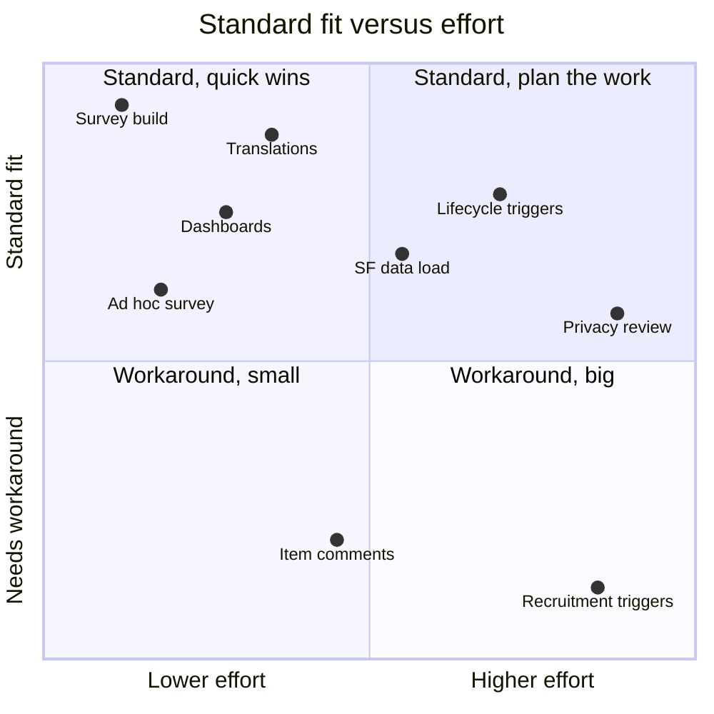
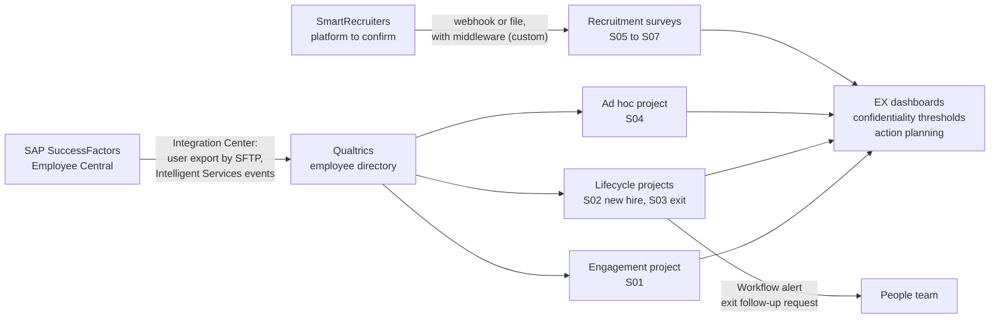

# Business Requirements: Qualtrics Feasibility Assessment

**What this is:** an analysis of the client's survey requirements workbook (7 surveys, 157 questions), checking each requirement against what **SAP Qualtrics Employee Experience (EX) can do in standard**, with a **what / why / how** for every requirement.

**Client:** kept anonymous throughout. The company is written as `[Company]` wherever question text names it.
**Date:** 26 November 2026.
**Status:** analysis for scoping. Nothing here has been built or tested in a Qualtrics tenant.

---

## The answer in one paragraph

**Yes, Qualtrics standard covers the programme.** Of 25 requirements, **8 work as delivered**, **14 work with configuration or SAP SuccessFactors-side set-up**, and **3 need a workaround** (per-item comments on the engagement survey, and the two SmartRecruiters trigger requirements). **None is impossible.** The real risks are not product limits. They are the 11 sensitive diversity questions (privacy review), small-team confidentiality thresholds on exit data, and the recruitment surveys, whose platform is still "to confirm".

---

## How to read the verdicts

| Verdict | Meaning |
|---|---|
| ✅ **Standard** | Available in the product as delivered. Set up in the Qualtrics interface, no code. |
| 🟡 **Standard + config** | Available, but needs deliberate configuration, a design decision, or SAP SuccessFactors-side set-up. Still no custom code. |
| 🟠 **Workaround** | Not a native feature. Achievable with custom code (JavaScript), middleware or an API integration, or a Qualtrics implementation service. |
| 🔴 **Not possible as stated** | Needs the requirement to change. **No requirement landed here.** |

"Standard" does not mean "no effort". Effort sizes (S, M, L) in the register are my relative estimates, not quotes.

| Verdict | Count |
|---|---|
| ✅ Standard | 8 |
| 🟡 Standard + config | 14 |
| 🟠 Workaround | 3 |
| 🔴 Not possible as stated | 0 |
| **Total** | **25** |

---

## Survey by survey

| ID | Survey | Items | Qualtrics project type | Verdict | What drives it |
|---|---|---|---|---|---|
| S01 | Annual engagement survey | 70 | Engagement | ✅ with one 🟠 | Per-item comments (BR-04) are a workaround; sensitive demographics need privacy review (BR-06, BR-25) |
| S02 | New hire 30-day check-in | 33 | Lifecycle | 🟡 | SuccessFactors data export, date-based participant automation, language handling |
| S03 | Exit survey | 23 | Lifecycle | 🟡 | Termination event timing, a "regretted leaver" flag that must exist in SuccessFactors, no hierarchy in Lifecycle, small-number thresholds |
| S04 | Remote employee (ad hoc) | 8 | Ad Hoc Employee Research | 🟡 | A SuccessFactors attribute is needed to identify remote staff |
| S05 | Candidate feedback | 6 | Platform to confirm | Content ✅, trigger 🟠 | No native Qualtrics connector to SmartRecruiters found |
| S06 | Selected candidate | 10 | Platform to confirm | Content ✅, trigger 🟠 | Same |
| S07 | Hiring manager | 7 | Platform to confirm | Content ✅, trigger 🟠 | Same |

---

## Where each feasibility sits against effort

*Reading it: top-left is where to start. Bottom-right (recruitment triggers) is where to decide early, because it depends on a platform choice the client has not made.*

---

## Target architecture (as assessed)

---

## What is in this folder

| File | What it holds | Read it when |
|---|---|---|
| [`README.md`](README.md) | This summary | You want the answer and the picture |
| [`01-requirements-register.md`](01-requirements-register.md) | All 25 requirements with verdict, effort, dependencies | You need a trackable list |
| [`02-what-why-how.md`](02-what-why-how.md) | **What / why / how** for each of the 25 requirements | You are designing or estimating the build |
| [`03-workbook-review-and-decisions.md`](03-workbook-review-and-decisions.md) | Data-quality findings in the workbook, survey by survey, plus 10 open decisions for the client | You are preparing the next client conversation |
| [`04-sources-and-verification.md`](04-sources-and-verification.md) | Sources, how strong each is, and what was **not** verified | You are about to quote a claim |

---

## Five things to raise with the client first

1. **Per-item comments (BR-04).** The workbook asks for an optional comment on all 54 rated items. No native per-item comment toggle was found in the documentation reviewed. Decide whether to keep it (custom code), reduce it (one comment per factor), or trigger it only on low scores.
2. **Confidentiality model (BR-03).** The workbook says "to be agreed". It changes how the survey is built and what the privacy notice must say.
3. **Recruitment platform (BR-21).** If recruitment surveys stay with SmartRecruiters or a partner tool, there is no integration to build in Qualtrics. If they move to Qualtrics, budget for a custom integration.
4. **"Regretted leaver" flag (BR-10).** The exit survey reports by regretted versus non-regretted leavers. That flag must exist in SuccessFactors, be set by someone, and be set **before** the survey is sent.
5. **Sensitive demographic questions (BR-06, BR-25).** Eleven voluntary diversity questions, spread across at least three countries, need a privacy review and local adaptation before translation and build.

---

## Caveats

- **Verification status.** [`04-sources-and-verification.md`](04-sources-and-verification.md) shows which claims were re-verified, which are community-reported, and which were not re-checked.
- **Documentation-based, not tested.** Every verdict comes from vendor documentation and practitioner reports. Validate the three workaround items and the SuccessFactors triggers in a sandbox before committing a plan.
- **Licensing was not checked.** Some features depend on the plan (for example AI comment summaries, journey analytics). Confirm entitlements with the account team.
- **Product details change.** SAP and Qualtrics rename and repackage features often. Check current documentation before quoting.
- **Local law was not researched.** Statements about privacy are design cautions, not legal advice.
- **No client data.** Question text is reproduced only where needed, with the company name replaced by `[Company]`.
