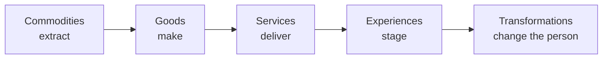
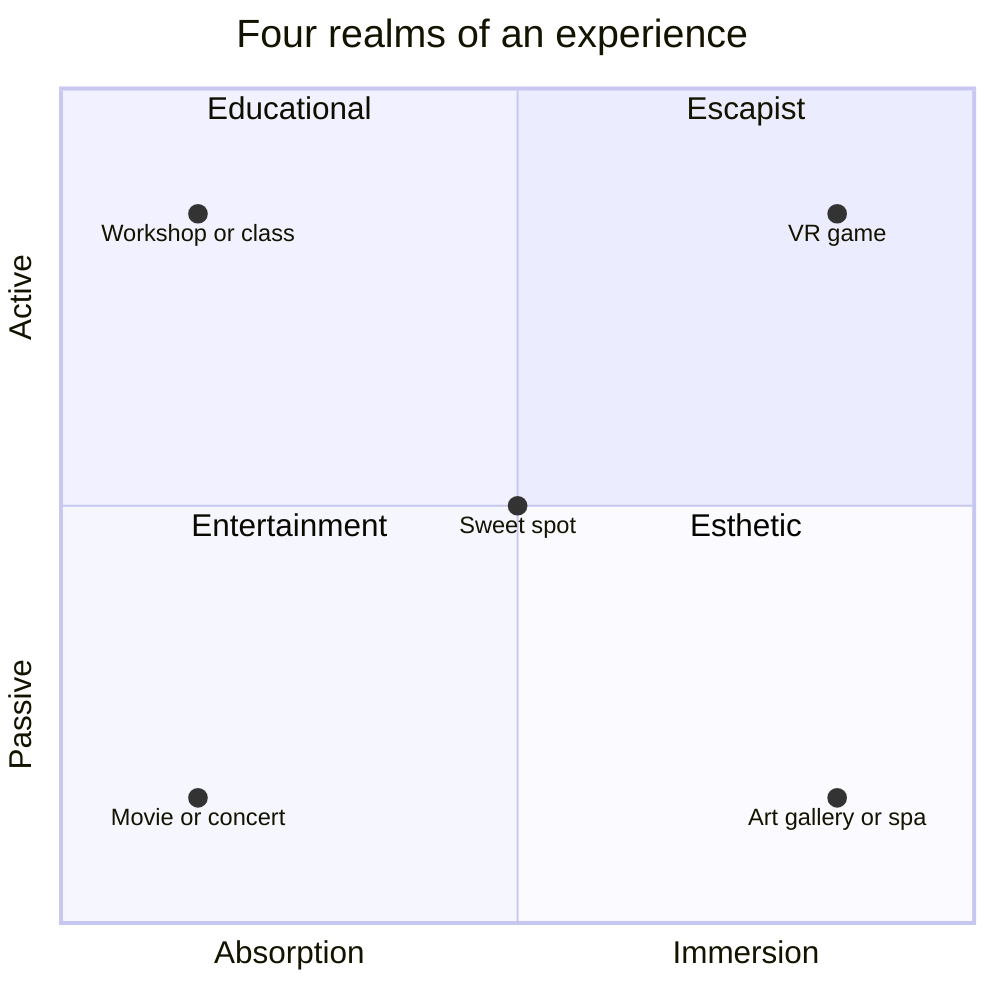
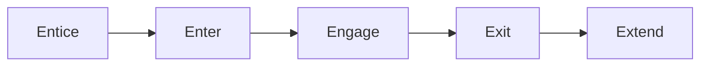
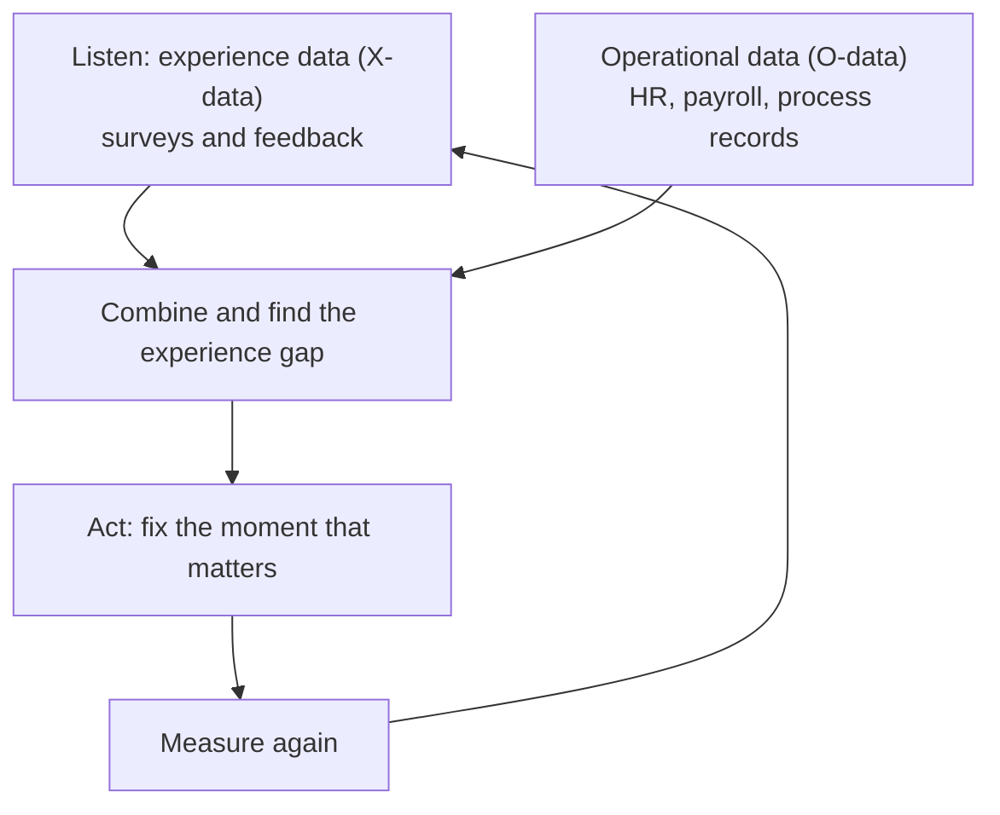

# The Experience Economy, From Scratch

**Part of HR10: Architecting Digital Employee Experience.** Last updated 4 November 2026.

This guide explains the experience economy from zero, then shows how the same idea applies to customer, employee, candidate, student, patient and user experience. It ends with revision aids: a glossary, rapid-fire questions and a self-test.

**How to read it**
- Sections 1 to 6 are the theory. They apply to any kind of experience.
- Section 7 maps the theory onto each category of experience.
- Section 8 goes deep on employee experience, the focus of HR10.
- Sections 9 and 10 cover measurement and the main criticisms.
- Section 11 has the study aids. Section 12 lists sources and what was not re-checked.

---

## The 60-second version

- For most of history people paid for **raw materials** (commodities), then for **things** (goods), then for **things done for them** (services).
- In 1998 Joseph Pine II and James Gilmore argued that a fourth kind of offering had become distinct: **experiences**, memorable events a business stages for its customers.
- An experience is **personal**. It is "inherently personal, existing only in the mind of an individual who has been engaged on multiple levels."
- **Why it matters:** when goods and services look alike, they compete on price. Experiences let a business stand apart and charge more. Pine's example: the coffee beans in a cup cost about 2 to 3 cents, but a café setting can charge $3 to $5 for that cup.
- There are **four realms** of experience (entertainment, educational, esthetic, escapist) and **five design principles** (theme, harmonize cues, remove negative cues, memorabilia, senses).
- The idea has a next step: the **transformation economy**, where people pay for an outcome, such as being healthier or more skilled.
- "Customer experience", "employee experience", "student experience" and the rest are the same idea with a different **guest**.
- The catch: you cannot manufacture feelings. Staged experiences must be **authentic**, and they must be **measured** with real data.

---

## 1. The big idea: a ladder of economic value

An **economic offering** is whatever a business sells. Pine and Gilmore describe a progression, where each step is more differentiated, and can command a higher price, than the one before. The textbook summary is: the progression of economic value moves "from extracting commodities to making goods to delivering services to staging experiences."

*Text version: Commodities (extract) → Goods (make) → Services (deliver) → Experiences (stage) → Transformations (change the person). Further right means more differentiation and a higher price.*

### Two worked examples

| Rung | Coffee | Birthday cake |
|---|---|---|
| **Commodity** | Coffee beans | Parents buy ingredients and bake |
| **Good** | Ground coffee in a packet (our illustration) | Parents buy a ready-made cake from a store |
| **Service** | Coffee brewed and served to you | Parents hire a party planner |
| **Experience** | A café visit built around the coffee | An all-inclusive, themed party at a specialised venue |
| **Transformation** | Coffee marketed as a path to a "happier, smarter, better-rested" self | n/a |

**What is the pattern?** Pine puts it this way: goods are the **props** and services are the **stage**, used to create a memory. He also says services are about time well *saved*, while experiences are about time well *spent*.

**Why does this happen?** Over time, goods and services get copied until they look the same, which is called **commoditization**. Pine's answer is that "customization is the antidote to commoditization": tailoring what you offer to the individual turns a service into an experience.

### Our learning example (same ladder, different field)

| Rung | Example |
|---|---|
| Commodity | Raw information: articles, manuals, documentation |
| Good | A recorded course you buy and watch alone |
| Service | A trainer delivers a class for you |
| Experience | An immersive cohort programme: a bootcamp, hackathon or live simulation |
| Transformation | You leave able to do a different job |

---

## 2. Where the idea came from

- **Authors:** B. Joseph Pine II and James H. Gilmore.
- **First published:** the Harvard Business Review article "Welcome to the Experience Economy" (July to August 1998), expanded into the book *The Experience Economy: Work Is Theatre & Every Business a Stage* (1999).
- **Turning point, in Pine's telling:** Disneyland's opening in 1955. Pine says experiences have always existed, but "now we can identify them as a distinct economic offering."
- **Digital technology** has widened what experiences can do. Pine notes tools that blend the real and the virtual, yet he still argues that reality "will now and forevermore provide the richest of experiences."
- **Related ideas that grew alongside it:** user experience (UX) design, experiential marketing, customer experience (CX) and employee experience (EX). Section 7 covers each.

---

## 3. What exactly is an experience?

An experience is a distinct offering, "as distinct from services as services are from goods." It is:

- **Personal:** it exists in the mind of the individual. Two people at the same event have two different experiences.
- **Memorable:** the memory is the product, not just the activity.
- **Engaging on several levels:** physical, emotional, intellectual, sometimes social.
- **Co-created:** the guest takes part, even if only by paying attention.

| | Service | Experience |
|---|---|---|
| Feels like | Something done *for* you | Something that happens *to* and *with* you |
| Judged on | Efficiency and outcome | Feeling and memory |
| Buyer is a | Client | Guest |
| Time is | Saved | Spent well |
| Example | Someone books your travel | A trip where every step was designed around you |

**A common mistake:** an experience is not the same as entertainment. Entertainment is only one of four realms of experience (next section).

---

## 4. The four realms of experience

Pine and Gilmore sort experiences along two dimensions:

1. **Customer participation:** *passive* (the guest does not affect the performance) to *active* (the guest helps create it).
2. **Connection:** *absorption* (the experience occupies the guest's attention from a distance) to *immersion* (the guest becomes physically or virtually part of it).

| Realm | Participation | Connection | Plain description | Examples |
|---|---|---|---|---|
| **Entertainment** | Passive | Absorption | You watch or listen | Movie, concert, dance performance |
| **Educational** | Active | Absorption | You learn by doing | Workshop, wine-tasting class, interactive museum exhibit |
| **Esthetic** | Passive | Immersion | You soak up the surroundings | Art gallery, scenic viewpoint, beautifully designed spa |
| **Escapist** | Active | Immersion | You step into another world and act in it | Virtual reality game, interactive theatre, extreme sports |

**The sweet spot** is the centre, where all four realms combine. The textbook example is a historical reenactment village: performances and storytelling (entertainment), learning about history (educational), accurately recreated surroundings (esthetic) and period costumes and activities (escapist).

**Mnemonic:** all four realms start with E: Entertainment, Educational, Esthetic, Escapist.

---

## 5. Five principles of experience design

| # | Principle | Plain meaning | Example |
|---|---|---|---|
| 1 | **Theme the experience** | One clear story running through everything | A new-joiner programme called "Your first 90 days to belonging" |
| 2 | **Harmonize impressions with positive cues** | Every detail supports the theme | A named buddy, a personal welcome note, a tidy desk |
| 3 | **Eliminate negative cues** | Remove anything that contradicts the theme | The laptop is not ready; the login fails on Day 1 |
| 4 | **Mix in memorabilia** | Tangible reminders the guest keeps | A welcome kit, a certificate, a team photo |
| 5 | **Engage all five senses** | More senses make the experience richer and more memorable | Space, sound, light, touch, even smell and taste (a shared meal) |

**Mnemonic: THEMS** (Theme, Harmonize cues, Eliminate negative cues, Memorabilia, Senses).

### Pine's five Es and the signature moment

Pine also recommends a dramatic structure with five stages, and a single **signature moment** that people remember.

*Entice them to come, make the entry smooth, engage them in the middle, make the exit memorable, then extend the relationship afterwards.*

### The peak-end rule (a related finding from psychology)

People tend to judge an experience by its most intense moment (the peak) and how it ended, not by the average of every minute. This is widely credited to Daniel Kahneman and colleagues. Practical lesson: invest in the **best moment** and the **last impression**, such as the final day of onboarding or the exit conversation. *(Not re-checked in this session; see section 12.)*

---

## 6. Beyond experiences: customization, authenticity and transformation

### Customization

When an offering is tailored to the individual, it feels like an experience. Pine's line is that mass customization turns a service into an experience.

### Authenticity

Pine and Gilmore followed the 1999 book with *Authenticity: What Consumers Really Want*. Pine says authenticity was tied to the experience economy from the start and affects every offering. **Plain version:** the more a business stages things, the more people ask "is this real?"

### Transformation: the fifth rung

Pine calls transformation "the fifth and final economic offering in this progression of economic value," usually delivered through a set of experiences that change people.

- **The rule:** "You are what you charge for." Goods: you charge for things. Services: you charge for activities. Transformations: you charge for **outcomes**.
- **The test:** "Any company that says it wants to help make you healthy, wealthy, or wise is really in the transformation business."
- **The buyer's mindset:** people want time **well invested**, not just time well spent.
- **Examples in the sources:** fitness coaching, executive and life coaching, retreats, and education models such as income share agreements, where students repay a share of their income.
- **Caution:** the Quartz article notes that market data is limited, so treat market-size numbers as indicative. Pine also warns: "Companies may try and infiltrate into a transformation what they want you to achieve." In other words, an outcome must be the guest's aim, not the company's.

**Why this matters for HR and education:** training, coaching and development are natural transformation businesses. The honest question is "who does this person become?" not "how many hours did we deliver?"

---

## 7. One idea, many experiences

Every "___ experience" asks three questions: **Who is the guest? What is being staged? What do they remember, or become?**

| Category | The guest | What is being staged | A defining source | Typical rung |
|---|---|---|---|---|
| **Customer (CX)** | Buyer or user of a product | Discovery, purchase, use, support, renewal | SAP paired Qualtrics customer experience software with its commerce, sales, service and marketing products | Service to experience |
| **Employee (EX)** | Worker | Hire, onboard, develop, perform, move, exit | Jacob Morgan: culture, technology and physical space | Service to experience |
| **Candidate** | Applicant | Attract, apply, interview, offer | An early chapter of the employee journey | Service |
| **Student / learner** | Learner | Enrol, onboard, learn, belong, graduate | Connected Student Report (Salesforce) | Experience to transformation |
| **Patient** | Person receiving care | Every interaction across the course of care | Beryl Institute definition | Service to experience |
| **User (UX)** | Person using a product or system | Every interaction with the product and company | Don Norman | Goods and services |
| **Citizen** | Person using public services | Applying, paying, getting help | Not researched here; the same pattern applied | Service |

**Definitions worth knowing**
- **User experience:** Don Norman, who coined the term, defined it as encompassing "all aspects of the end user's interaction with the company, its services, and its products." He joined Apple in 1993, where he and colleagues formed the "User Experience Architect's Office."
- **Patient experience:** the Beryl Institute defines it as "the sum of all interactions, shaped by an organization's culture, that influence patient perceptions across the continuum of care." Note the three parts: interactions, culture, perceptions.
- **Employee experience:** Morgan describes a shift from a *utility* view ("people need to show up at work") to an *experience* view ("people want to show up at work").

The pattern also extends to guests, passengers, members, donors, partners, vendors and alumni. *(Extrapolation: not individually researched.)*

### The four realms applied (illustrative examples)

| Realm | Employee | Customer | Student |
|---|---|---|---|
| **Entertainment** | All-hands meetings, celebrations | Brand events and showcases | Guest lectures, performances |
| **Educational** | Learning academies, mentoring | Tutorials, customer workshops | Classes, labs, studios |
| **Esthetic** | Office or campus design, a well-designed intranet | Store and packaging design | Campus and learning-space design |
| **Escapist** | Hackathons, offsites, simulations | Flagship brand worlds | Field trips, simulations, hackathons |

Pine's own examples of flagship brand experiences are the World of Coca-Cola, the Heineken Experience and the Guinness Storehouse.

### What the student evidence says

A vendor survey, the Connected Student Report (third edition, authored by Salesforce, 2,668 respondents), reported that:
- only about one third of students had a great university experience;
- only 12% said they fully belong;
- students with a great onboarding experience were 35 times more likely to have a great overall experience.

These figures are **vendor-reported and indicative**. They echo a point employers know well: **onboarding sets the tone** (see 8.3).

---

## 8. Employee experience in depth

### 8.1 From utility to experience

Under the old **utility** view, work is something people have to turn up for. Under the **experience** view, the organisation is designed so "people truly want to show up." Morgan's research covered more than 250 companies, and he found technology to be the most impactful trend shaping the future of work.

### 8.2 The three environments

| Environment | What it includes |
|---|---|
| **Cultural** | Structure, leadership approach, work styles, pay and benefits, performance, people and purpose |
| **Technological** | Devices, applications, software, user experience and design, digital transformation |
| **Physical space** | Workplace layout, perks, demographics and creative design of the workplace |

**Digital employee experience (DEX)** sits in the technological environment: how it feels, and how long it takes, to do everyday tasks in HR and workplace systems.

### 8.3 The employee journey as a staged experience

**Onboarding as a worked example of the five principles**

| Principle | In onboarding |
|---|---|
| Theme | "Welcome to belonging": one story across offer, Day 1 and the first 90 days |
| Positive cues | Named buddy, personal message from the manager, clear plan |
| Eliminate negative cues | Equipment ready, access working, payroll set up correctly |
| Memorabilia | Welcome kit, a meaningful first-week task completed |
| Senses | A welcoming space, a shared meal, good audio and video for remote hires |

**Moments that matter:** think of the journey as a few high-stakes moments (first day, first pay, first review, promotion, exit) rather than hundreds of equal steps.

**The ladder in HR (illustrative):** *payroll* is a service (pay people correctly and on time). A *payday experience* adds clarity, speed and no surprises. A *financial wellbeing* programme aims at a transformation: people become more secure.

### 8.4 Experience data and operational data

SAP's 2019 acquisition of Qualtrics (reported at $8 billion) put a name on this combination:

- **X-data (experience data):** what people *feel and say*. Qualtrics collects it through surveys and feedback.
- **O-data (operational data):** what *happened* in systems: hires, exits, pay, tickets, process times.
- CEO Bill McDermott framed the problem as an **experience gap**: "Every CEO is trying to solve the experience gap of what they expect versus what they actually achieve," and said SAP "must be the platform that combines X- and O-data."

**A real example of combining both:** Tecnológico de Monterrey measures how employees feel *and* how much time and how many clicks tasks take, then changes the process to improve the experience.

**In SAP SuccessFactors terms:** the 2019 plans described an employee lifecycle solution that could trigger surveys at milestones such as onboarding, training, promotion and exit. In January 2025 SAP and Qualtrics announced that SuccessFactors customers can contract Qualtrics XM for Employee Experience under an SAP Endorsed Apps agreement. Product names and packaging change often, so check current options with SAP and Qualtrics.

**Practical next step:** see the [Qualtrics EX Scoping Toolkit](00-Qualtrics-EX-Scoping-Toolkit/README.md) in this folder for a 200-question questionnaire that turns these ideas into scoping questions.

---

## 9. Measuring experience

| Category | Common measures (general practice) |
|---|---|
| Customer | Net Promoter Score (NPS), satisfaction (CSAT), customer effort |
| Employee | Engagement, employee NPS (eNPS), lifecycle pulses (onboarding, exit) |
| Student | Belonging, satisfaction, retention |
| Patient | Patient experience surveys (for example HCAHPS in the US) |
| User | Task success, time on task, usability scores |

**Three habits make measurement useful**
1. **Pair X-data with O-data.** Feelings explain the numbers; the numbers show where it hurts.
2. **Measure the moments that matter,** not everything.
3. **Close the loop.** People stop answering when nothing visibly changes ("you said, we did").

*(Measures in this table are general practice and were not individually sourced; see section 12.)*

---

## 10. Criticisms and limits

1. **Staged versus real.** If everything is staged, people look for what is genuine. This is the authenticity point from section 6.
2. **You cannot manufacture feelings.** A critique of student "belonging" programmes argues that colleges can create opportunities but cannot force students to connect. Its own data point is balanced: an EAB survey of 12,600 young adults found belonging was highly correlated with satisfaction, and 31% of students reported feeling targeted, criticised or excluded based on their identity. Both the vendor view and the critique have a stake, so weigh them against your own evidence.
3. **Transformation can be self-serving.** Pine's own warning (section 6): do not smuggle the company's goals into the guest's journey.
4. **Evidence is often thin.** Market-size figures are limited, and many statistics come from vendor surveys. One SuccessFactors customer's reaction to integration claims was blunt: "I'm not into vaporware."
5. **Experience does not replace fundamentals.** In an employee setting, pay, fairness and workload shape experience more than any programme can (our view).
6. **Employees as performers.** If a brand experience requires staff to act out emotions, the cost falls on them (the idea of emotional labour; general knowledge, not re-checked).
7. **Trust and privacy.** Listening to employees needs clear anonymity rules, consent and country-level legal review. The scoping toolkit in this folder has a full section on this.

---

## 11. Study aids

### Glossary

| Term | Meaning |
|---|---|
| Economic offering | What a business sells: commodity, good, service, experience or transformation |
| Commoditization | When offerings look alike, so price becomes the only difference |
| Experience | A personal, memorable event a business stages for a guest |
| Guest | The person who receives an experience |
| Realm | One of four types of experience: entertainment, educational, esthetic, escapist |
| Absorption / immersion | Taking an experience in from a distance / becoming part of it |
| Sweet spot | The centre where all four realms combine |
| Negative cue | Any detail that contradicts the intended experience |
| Memorabilia | A tangible reminder of an experience |
| Signature moment | The single moment people remember most |
| Transformation | An offering whose value is a lasting change in the buyer |
| X-data / O-data | Experience data (what people feel and say) / operational data (what happened in systems) |

### Rapid-fire revision

| Question | Answer |
|---|---|
| Name the five rungs of the ladder. | Commodities, goods, services, experiences, transformations |
| Who proposed the experience economy, and when? | Pine and Gilmore, HBR 1998 |
| Why can experiences charge more? | They differentiate; coffee beans cost cents per cup, a café setting charges $3 to $5 |
| Define an experience. | Personal, memorable, engages the guest on multiple levels |
| Two axes of the realms? | Participation (passive to active); connection (absorption to immersion) |
| Four realms? | Entertainment, educational, esthetic, escapist |
| What is the sweet spot? | Where all four realms combine |
| Five design principles? | Theme, harmonize cues, eliminate negative cues, memorabilia, senses (THEMS) |
| Give a negative cue in onboarding. | Laptop not ready on Day 1 |
| What is the next rung after experience? | Transformation: you charge for outcomes |
| Three environments of employee experience? | Cultural, technological, physical space |
| X-data versus O-data? | What people feel versus what happened |
| Who coined "user experience"? | Don Norman, at Apple |
| Main criticism? | Staging cannot manufacture authenticity or belonging |

### Self-test

**1. A company sells a packaged cake mix. Which rung is this?**
- (a) Commodity (b) Good (c) Service (d) Experience

Answer
(b) Good. The ingredients are commodities; a packaged mix is a made good.

**2. A guest in a workshop learns by actively taking part but stays outside the "world" of the event. Which realm?**
- (a) Entertainment (b) Educational (c) Esthetic (d) Escapist

Answer
(b) Educational: active participation with absorption.

**3. An art gallery or beautifully designed spa sits in which realm?**
- (a) Entertainment (b) Educational (c) Esthetic (d) Escapist

Answer
(c) Esthetic: passive participation with immersion.

**4. A new hire cannot log in on Day 1. Which design principle is breached?**
- (a) Theme (b) Memorabilia (c) Eliminate negative cues (d) Engage the senses

Answer
(c) Eliminate negative cues. The failed login contradicts the "welcome" theme.

**5. "You are what you charge for" best describes which rung?**
- (a) Goods (b) Services (c) Experiences (d) Transformations

Answer
(d) Transformations: you charge for outcomes, not things or activities. (Pine's rule applies across rungs, but it is most important for transformation.)

**6. Which is NOT one of Morgan's three environments?**
- (a) Cultural (b) Technological (c) Physical space (d) Financial

Answer
(d) Financial. The three are cultural, technological and physical space.

**7. Tecnológico de Monterrey measures "how they feel" and "how many clicks". This is an example of:**
- (a) Using only X-data (b) Using only O-data (c) Combining X-data and O-data (d) Benchmarking

Answer
(c) Combining X-data and O-data.

**8. Which is the best summary of the main criticism of "experience" programmes?**
- (a) Experiences cost too much (b) Organisations cannot manufacture authenticity or belonging (c) Goods matter more than services (d) Surveys are illegal

Answer
(b) Organisations can create opportunities and remove obstacles, but cannot force people to feel connected.

### Practice exercise: redesign one moment

1. Pick one moment that matters (for example, Day 1, first payslip, or exit).
2. Name the **guest** and what they should **feel or remember**.
3. List the **negative cues** to remove first.
4. Add **positive cues**, one piece of **memorabilia** and a **signature moment**.
5. Decide how you will **measure** it: one experience measure plus one operational measure.

---

## 12. Sources and verification notes

### Sources used

| Source | Used for |
|---|---|
| [University of Utah textbook chapter 17, The Experience Economy (UEN Pressbooks)](https://uen.pressbooks.pub/servicesmgt/chapter/chapter-17-the-experience-economy/) | Definition of an experience, value progression, birthday cake example, four realms, design principles, sweet spot |
| [Joe Pine: Exploring the Experience Economy, Revisited (Future of StoryTelling)](https://futureofstorytelling.org/case-study/joe-pine-exploring-the-experience-economy-revisited/) | Coffee cost example, props and stage, time well spent, customization, authenticity, five Es, signature moment, transformation as fifth offering, Whirlpool and flagship brand examples |
| [Quartz: The transformation economy is the new experience economy](https://qz.com/1753892/the-transformation-economy-is-the-new-experience-economy) | "You are what you charge for", healthy, wealthy, wise, coffee ladder, examples, cautions |
| [InfoQ: Employee experience (Jacob Morgan)](https://www.infoq.com/news/2017/02/employee-experience) | Utility versus experience, three environments, 250 companies |
| [Interaction Design Foundation: Don Norman](https://ixdf.org/literature/topics/don-norman) | UX definition, Apple 1993 |
| [The Beryl Institute: Defining Patient Experience](https://theberylinstitute.org/defining-patient-experience/) | Patient experience definition |
| [Computerworld: SAP commits to experience management following Qualtrics acquisition (May 2019)](https://www.computerworld.com/article/1656357/sap-commits-to-experience-management-following-qualtrics-acquisition.html) | X-data, O-data, experience gap, lifecycle surveys |
| [TechTarget: SuccessFactors customers to see big Qualtrics impact](https://www.techtarget.com/searchhrsoftware/news/252470901/SuccessFactors-customers-to-see-big-Qualtrics-impact) | Tecnológico de Monterrey example, customer skepticism |
| [Qualtrics and SAP announce new partnership (January 2025)](https://www.qualtrics.com/articles/news/qualtrics-and-sap-announce-new-partnership-to-help-organizations-deliver-great-employee-experiences/) | SAP Endorsed Apps agreement for Qualtrics XM for Employee Experience |
| [Fierce Network: Belonging and connection is the foundation for student success](https://www.fierce-network.com/student-engagement/belonging-and-connection-foundation-student-success) | Connected Student Report figures (vendor-reported) |
| [James G. Martin Center: Colleges can't curate belonging](https://jamesgmartin.center/2024/10/colleges-cant-curate-belonging/) | Critique of engineering belonging, EAB survey figures |

### Not re-checked against a source in this session

These come from general knowledge and should be verified before you quote them formally:
- Publication years: the 1999 book and the *Authenticity* follow-up. The 1998 HBR article date is based on its web address.
- The peak-end rule and its attribution to Daniel Kahneman.
- The standard measures in section 9 (NPS, CSAT, customer effort, eNPS, HCAHPS, usability scores).
- The emotional labour point in section 10.
- The "citizen experience" row and the extension to guests, passengers, members, donors, partners, vendors and alumni.
- Our own illustrations: the learning ladder, the payroll ladder, the onboarding table, and the four-realms-applied table.

### Notes on source quality
- The Connected Student Report is a **vendor** report (Salesforce). The Martin Center piece comes from a think tank with its own viewpoint. Use both with care.
- The SAP and Qualtrics articles are from 2019 and describe plans at that time. Product names and packaging have changed since.
